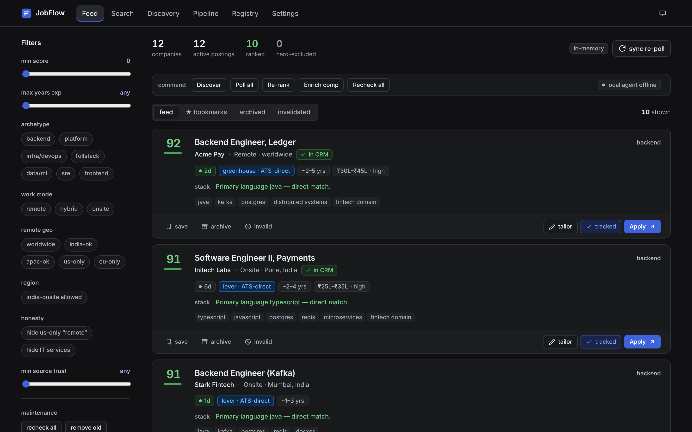
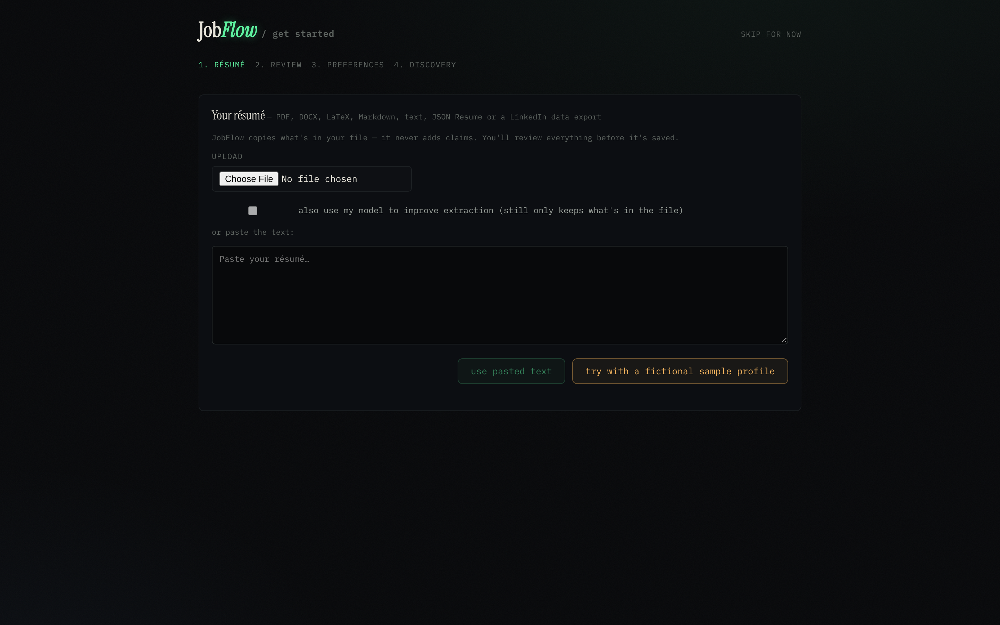
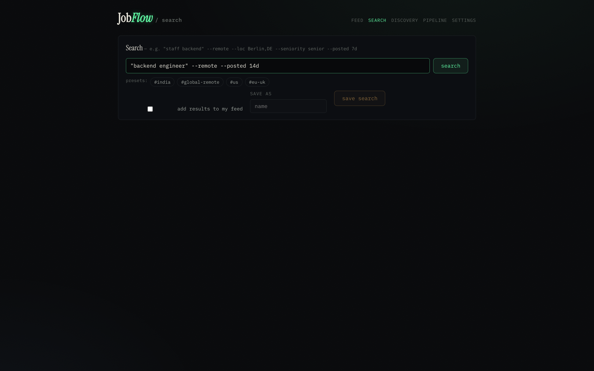
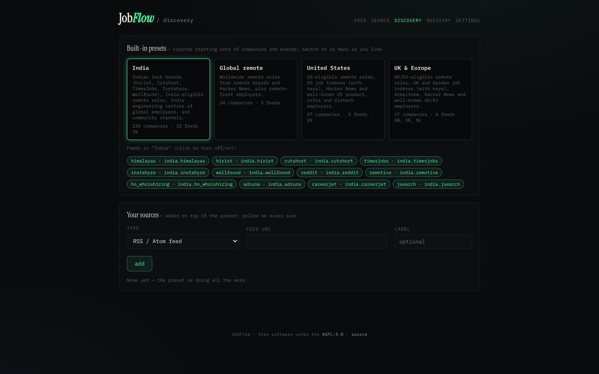
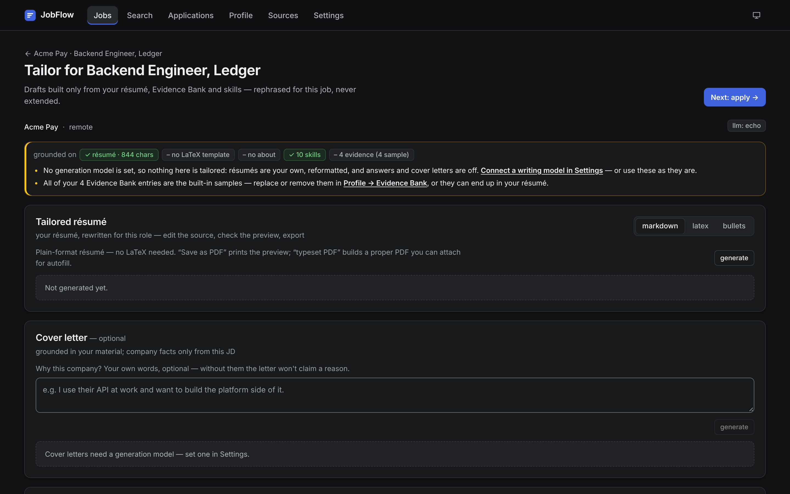
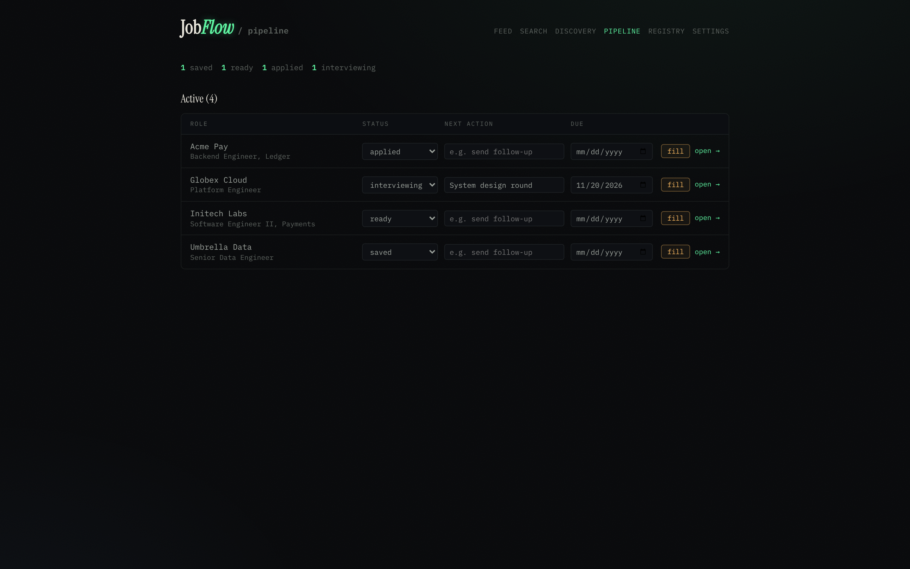

# JobFlow

**A local-first job search engine for one person: it finds roles across hundreds of company
boards, ranks them against *your* résumé with honest match cards, tailors your documents
from your own material, and pre-fills applications — then stops so you can review and
submit.**

[](https://github.com/jagritvats/autohire/actions/workflows/ci.yml)
[](LICENSE)




```bash
git clone https://github.com/jagritvats/autohire.git jobflow && cd jobflow
pnpm install && pnpm -r build
pnpm jobflow init                                 # your résumé + preferences, reviewed by you
pnpm jobflow search "backend engineer" --remote   # live search, scored against you
pnpm jobflow apply '#1' --fill                    # pre-fill the form; you review and submit
```

No account, no server, no API keys needed. Your data stays in `~/.jobflow`.

---

## Why JobFlow

Job boards rank by recency and ads; most "AI apply" tools spray applications and invent
experience. JobFlow takes the opposite bet:

- **Good job finding.** ATS APIs (Greenhouse, Lever, Ashby, Workable, SmartRecruiters,
  Workday and more) are the spine: clean, complete, ghost-free postings straight from the
  employer. Aggregators, RSS/JSON feeds, HN "Who is hiring" and community channels add
  breadth; an ATS detector turns any company name or careers URL into a pollable board.
- **Honest recommendations.** The match card is the product: why it fits, the likely gap,
  how far the stack is from yours, probable pay (stated or clearly marked as an estimate), and
  red flags like a "remote" role that's US-only. Almost nothing is a hard filter — a Java
  developer still sees Go roles, with an honest ramp note.
- **Grounded applications.** Tailored résumés, cover letters and answers come only from your
  résumé, your Evidence Bank and your declared skills — rephrased and trimmed, never extended.
- **A human at the gate.** The form-filler types what you stored and stops at the review
  screen. There is no auto-submit, by design and by test.

## Features

| | |
|---|---|
| **Résumé import** — PDF, DOCX, LaTeX, Markdown, JSON Resume or a LinkedIn export, parsed into skills, experience and citeable evidence you review |  |
| **Search** — ask the search-capable boards a question now; results are scored with your profile, filters report what they hid; save it to run on a schedule |  |
| **Configurable discovery** — start from a preset (India, Global remote, US, Europe & UK) and add your own companies, CSV lists, RSS/JSON feeds, Telegram channels and HN threads |  |
| **Tailoring** — résumé variants, LaTeX/Markdown rewrites with PDF preview, cover letters, application answers |  |
| **Pipeline** — track applications from saved to offer, with next actions and a don't-double-apply guard |  |

Also: salary estimates with confidence (stated pay is never mixed with estimates), freshness
and liveness checks, a browser extension with an inline match panel, and an optional local
agent for logged-in sites.

## Quick start

See **[docs/getting-started.md](docs/getting-started.md)**. The short version:

```bash
pnpm jobflow init        # or: pnpm jobflow init --sample  (a fictional candidate)
pnpm jobflow sync        # poll your discovery preset + sources, then rank
pnpm jobflow feed        # ranked match cards
pnpm jobflow search "data engineer" --loc "Berlin,DE" --posted 7d --save-as berlin-data
pnpm jobflow tailor '#1'
pnpm jobflow apply '#1' --fill
pnpm jobflow track status '#1' applied
pnpm jobflow serve       # the same data in the web UI at http://localhost:3000
```

Add an LLM for richer write-ups and prose (optional):

```bash
pnpm jobflow config set llm.provider anthropic
pnpm jobflow config set llm.key --stdin
```

Always-on with Docker (Postgres + web + scheduled worker): `pnpm docker:up`.

## Safety & ethics

| Tier | Sources | Runs |
|---|---|---|
| 1–2 | ATS APIs, public boards, feeds you add | CLI, web app, worker |
| 3 | LinkedIn, Naukri, Glassdoor, AmbitionBox | **only** the local agent, in your own browser, off by default |

- The server side never holds your session for a logged-in site.
- The form-filler never submits; `JOBFLOW_AUTOSUBMIT` is hard-wired false.
- User-supplied URLs are SSRF-guarded; uploads live outside the source tree.
- Your terms-of-service obligations to each site are yours — see
  [docs/legal-and-ethics.md](docs/legal-and-ethics.md).

## Documentation

- [Getting started](docs/getting-started.md) · [CLI reference](docs/cli.md) · [Configuration](docs/configuration.md)
- Guides: [résumé & profile](docs/guides/resume-and-profile.md) · [search & discovery](docs/guides/search-and-discovery.md) · [applying](docs/guides/apply.md) · [LLM providers](docs/guides/llm-providers.md) · [self-hosting for several people](docs/guides/self-hosting.md)
- [Architecture](docs/architecture.md)

## Repository

```
packages/  core · adapters · db · llm · pipeline · resume-io · service · autofill
apps/      cli · web · worker · agent · extension
```

Full TypeScript, one Zod type system end to end. `pnpm -r test` runs ~600 tests offline.

## Contributing

Contributions are welcome — new job sources, ATS detectors, presets, parsers and UI. Read
[CONTRIBUTING.md](CONTRIBUTING.md) for setup and the invariants every change keeps. Please
report security issues privately ([SECURITY.md](SECURITY.md)).

## License

[MIT](LICENSE). Salary benchmarks from levels.fyi are shown with attribution.
