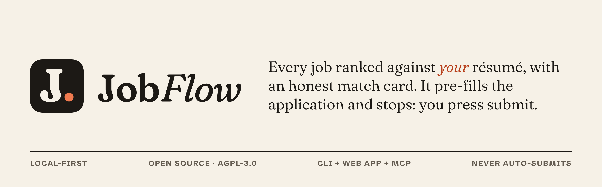
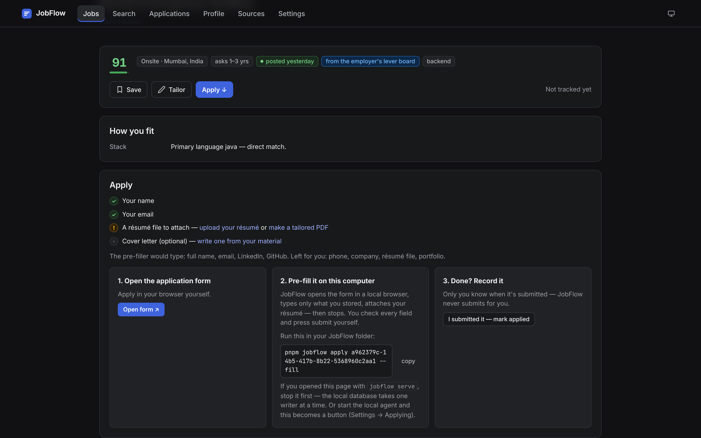
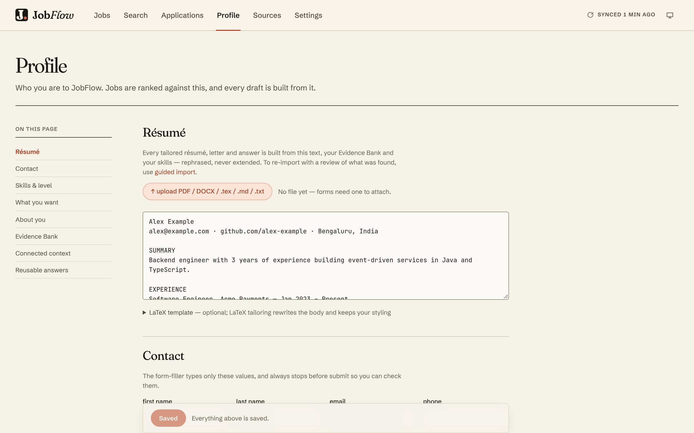
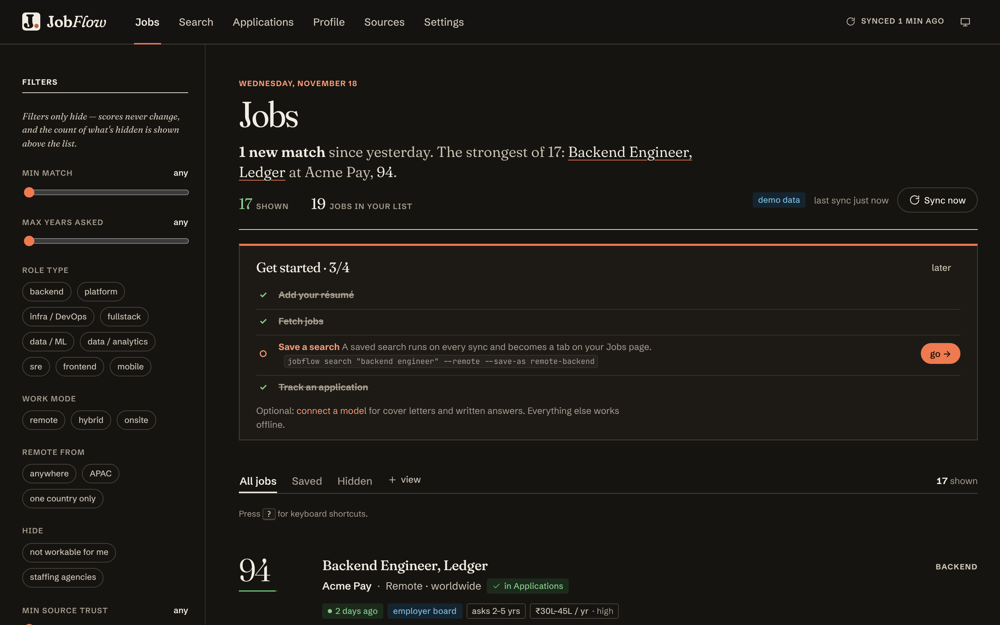
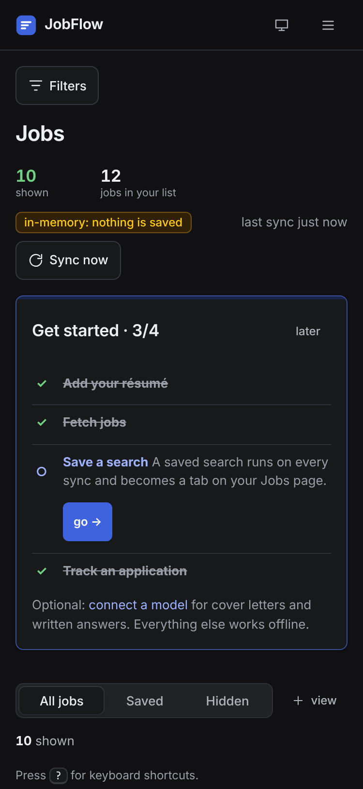
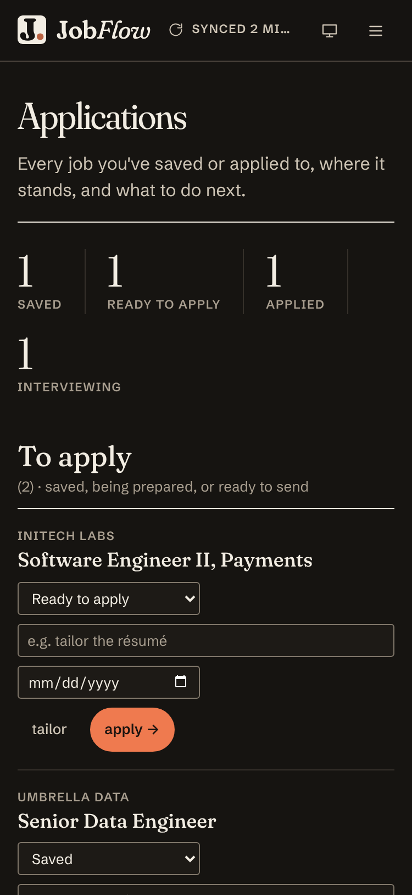
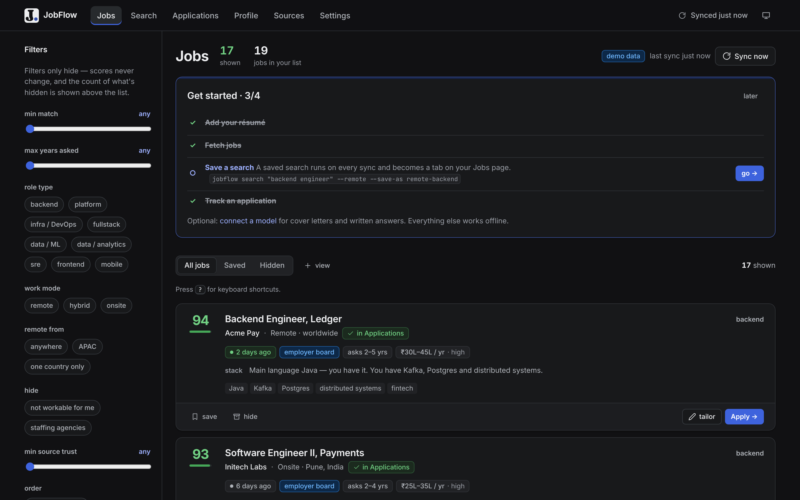
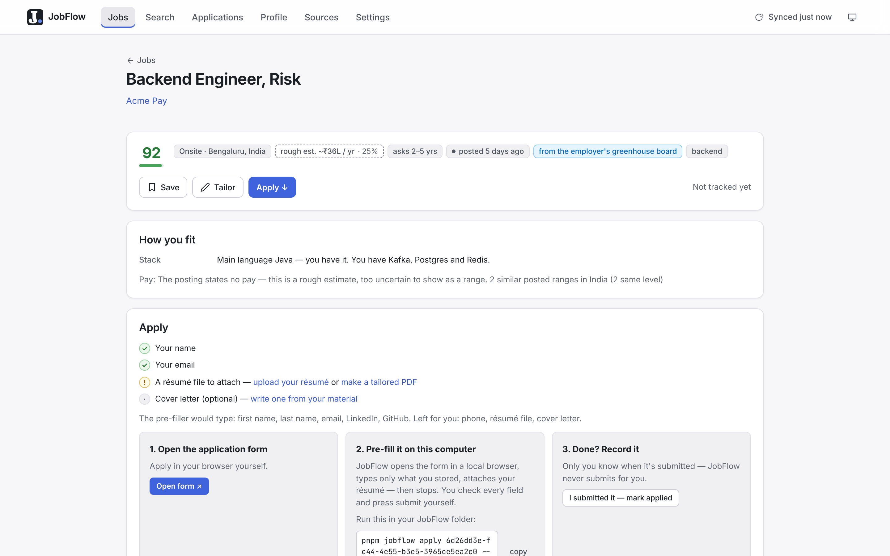
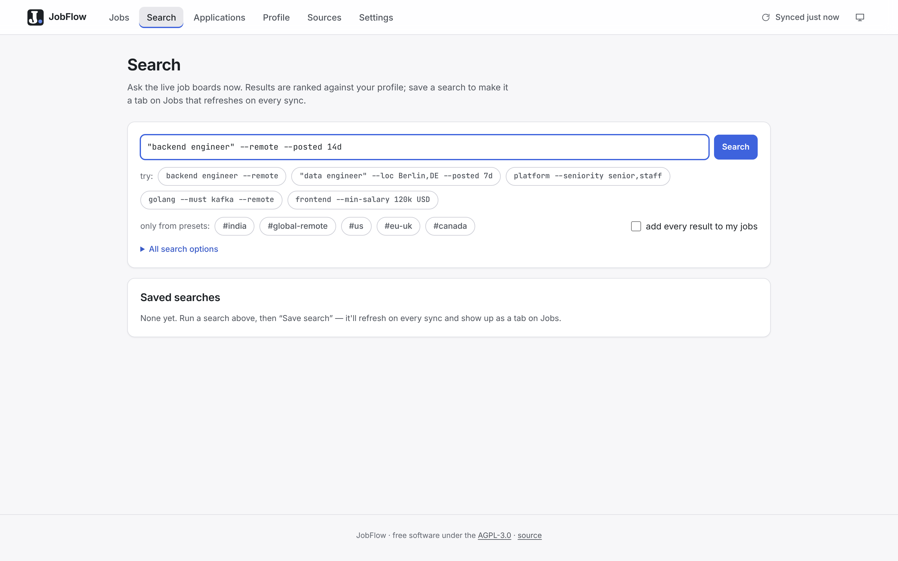
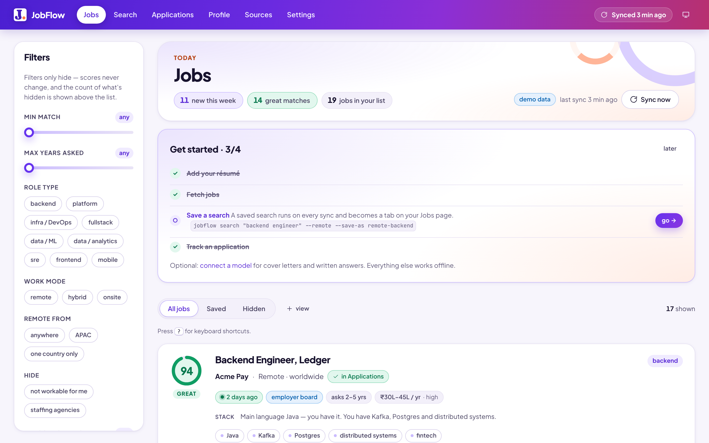

<h1>
  <picture>
    <source media="(prefers-color-scheme: dark)" srcset="brand/social/readme-banner-dark.png">
    
  </picture>
</h1>

**A local-first job search engine for one person. It finds roles across hundreds of company
boards, ranks them against *your* résumé with honest match cards, tailors your documents from
your own material, and pre-fills applications. Then it stops, so you can review and submit.**

[](https://github.com/jagritvats/jobflow/actions/workflows/ci.yml)
[](LICENSE)


## Quick start

```bash
git clone https://github.com/jagritvats/jobflow.git && cd jobflow
pnpm install && pnpm -r build
pnpm jobflow init && pnpm jobflow sync    # your résumé, reviewed by you; then fetch and rank jobs
pnpm jobflow serve                        # the web app at http://localhost:3000 (or stay in the terminal)
```

You need Node 20.11+ (22 recommended) and pnpm 9 (`corepack enable`). You don't need an
account, a server or an API key. Your data stays in `~/.jobflow`. Want to
look around first? `pnpm jobflow init --sample` loads a fictional candidate. The full
walkthrough is in **[Getting started](docs/getting-started.md)**.

## What it looks like

<table>
  <tr>
    <td width="50%" valign="top">
      <a href="docs/screenshots/jobs.png"></a>
      <br><b>Jobs</b>: your ranked list. Saved searches become tabs, and filters only hide; they always say how many jobs they hid.
    </td>
    <td width="50%" valign="top">
      <a href="docs/screenshots/job-apply.png"></a>
      <br><b>Job page</b>: how you fit, the full description, and an apply checklist that fixes each gap before you open or pre-fill the form.
    </td>
  </tr>
  <tr>
    <td valign="top">
      <a href="docs/screenshots/search.png"></a>
      <br><b>Search</b>: ask the live boards now with example queries and preset tags, then save a search to make it a Jobs tab.
    </td>
    <td valign="top">
      <a href="docs/screenshots/sources.png"></a>
      <br><b>Sources</b>: switch on presets (India, Global remote, US, UK &amp; Europe), add your own feeds and companies, and sync.
    </td>
  </tr>
  <tr>
    <td valign="top">
      <a href="docs/screenshots/profile.png"></a>
      <br><b>Profile</b>: your résumé, contact details, skills, what you want, and the Evidence Bank every draft is built from.
    </td>
    <td valign="top">
      <a href="docs/screenshots/applications.png"></a>
      <br><b>Applications</b>: each application from saved to offer, with a next step and a follow-up date for each.
    </td>
  </tr>
  <tr>
    <td valign="top">
      <a href="docs/screenshots/tailor.png"></a>
      <br><b>Tailor</b>: résumé, cover letter and answers built from your material. Each draft is labelled with its source.
    </td>
    <td valign="top">
      <a href="docs/screenshots/apply-review-gate.png"></a>
      <br><b>The review gate</b>: <code>jobflow apply --fill</code> types what you stored, attaches your résumé, and stops. You press submit.
    </td>
  </tr>
  <tr>
    <td valign="top">
      <a href="docs/screenshots/jobs-dark.png"></a>
      <br><b>Light or dark</b>: the theme follows your system, or pick one with the toggle in the header.
    </td>
    <td valign="top">
      <a href="docs/screenshots/cli-search.png"></a>
      <br><b>The CLI</b>: every page has a command. <code>jobflow search</code> scores live results against you and reports what the query hid.
    </td>
  </tr>
</table>

<p align="center">
  
  
  
  
  <br><em>Every page works on a phone. The filters open as a sheet.</em>
</p>

### Three styles, one app

**Settings → Appearance** switches the whole app between **Editorial** (the default, shown
above), **Classic** (the original clean, neutral design) and **Spark** (bold and colourful).
Each comes in light and dark, and your choice applies before the page draws.

<table>
  <tr>
    <td width="50%" valign="top">
      <a href="docs/screenshots/classic-jobs-dark.png"></a>
      <br><b>Classic · Jobs</b>: Inter type, a neutral palette and one indigo accent.
    </td>
    <td width="50%" valign="top">
      <a href="docs/screenshots/classic-job-light.png"></a>
      <br><b>Classic · Job page</b>: the same fit notes, pay and apply checklist in compact cards.
    </td>
  </tr>
  <tr>
    <td valign="top">
      <a href="docs/screenshots/classic-search-light.png"></a>
      <br><b>Classic · Search</b>
    </td>
    <td valign="top">
      <a href="docs/screenshots/styles-spark-light.png"></a>
      <br><b>Spark · Jobs</b>: a gradient header, score rings and a "today" summary.
    </td>
  </tr>
</table>

More screenshots, page by page, are in the [web app tour](docs/guides/web-app-tour.md); every
style in both themes is in `docs/screenshots/styles-*.png` and `classic-*.png`.

## Why JobFlow

Job boards rank by recency and ads, and most "AI apply" tools send out applications in bulk
and invent experience. JobFlow does the opposite:

- **Good job finding.** ATS APIs (Greenhouse, Lever, Ashby, Workable, SmartRecruiters,
  Workday and more) are the core. Postings come straight from the employer: clean, complete,
  and with no ghost listings. Aggregators, RSS/JSON feeds, HN "Who is hiring" and community
  channels add breadth. An ATS detector turns any company name or careers URL into a board
  that JobFlow polls.
- **Honest recommendations.** The match card is the product. It shows why a role fits, the
  likely gap, how far the stack is from yours, and probable pay (stated, or clearly marked as
  an estimate). It also shows red flags, such as a "remote" role that's US-only. Almost nothing
  is a hard filter: a Java developer still sees Go roles, with an honest note about the ramp-up.
- **Grounded applications.** Tailored résumés, cover letters and answers come only from your
  résumé, your Evidence Bank and your declared skills. They are rephrased and trimmed, never
  extended.
- **A human at the gate.** The form-filler types what you stored and stops at the review
  screen. There is no auto-submit, by design and by test.

## Features

- **Discovery**: four presets you can combine (India, Global remote, United States, Europe &
  UK). You can also add companies, CSV company lists, RSS/Atom and JSON feeds, Telegram
  channels and HN threads. Sync on demand; the web app also syncs every 6 hours while it's
  open.
- **Search**: live search across the boards that support it, with `--remote`, `--loc`,
  `--seniority`, `--min-salary`, `--posted`, `--must`/`--nice`, `--preset` and more. Save a
  search and it runs on every sync and becomes a tab on Jobs.
- **Match cards**: a score, fit and gap notes, stack distance, seniority and experience gap,
  stated pay or a labelled estimate with its confidence, source trust and red flags. Only two
  things are ever excluded outright: a confidently stated salary below your floor, and a
  location you can't work from.
- **Freshness**: re-polling never duplicates a posting. Postings that disappear from their
  board are retired, reposts don't look new, and with the worker running (Docker), your top
  jobs are re-checked between polls.
- **Résumé import**: PDF, DOCX, LaTeX, Markdown, text, JSON Resume or a LinkedIn data export.
  Extraction copies spans from your file, and you review everything before it's saved.
- **Tailoring**: résumé variants, Markdown and LaTeX rewrites with a PDF preview, cover
  letters and application answers. Your LaTeX preamble is kept byte-for-byte.
- **Applying**: a dry run shows what would be typed where. Open the form, or pre-fill it in a
  local browser (Greenhouse, Lever, Ashby, Workable and Workday field maps, and a cautious
  generic map for other forms). JobFlow never submits.
- **Tracking**: statuses from saved to offer, next steps, follow-up dates, and a guard against
  applying twice.
- **Optional extras**: an LLM (Anthropic, OpenAI, xAI or an OpenAI-compatible gateway) for
  richer write-ups and prose; a browser extension with an inline match panel; a local agent
  for logged-in sites and one-click pre-fill in your own browser (it shares a Postgres
  database with the web app, such as Docker's); Docker; and a multi-user hosting mode.

## How it works

```
 your résumé ──► Profile + Evidence Bank ─────────────────────────┐
                                                                  ▼
 presets + your sources ──► discover ─► poll ─► normalize ─► rank ─► Jobs / feed
 (ATS APIs, boards, feeds)              (idempotent upserts)  (match cards)
                                                                  │
                    Tailor (grounded drafts) ◄────────────────────┤
                    Apply (checklist → open / pre-fill → you submit) ◄┘
```

One TypeScript monorepo with one Zod type system: `packages/core` (pure matching and
normalization logic), `adapters` (one per source), `pipeline`, `db` (PGlite locally, Postgres
when hosted), `llm`, `autofill`, `service`, and the `cli`, `web`, `worker`, `agent` and
`extension` apps. See [docs/architecture.md](docs/architecture.md).

## Use it from Claude Code and other AI agents

`jobflow mcp` serves JobFlow over the [Model Context Protocol](https://modelcontextprotocol.io).
An agent can then query JobFlow's data layer instead of scraping job boards: live search,
your ranked feed with honest flags, one job in full, the tracker, a dry-run apply plan, and
drafts grounded in your own material.

```bash
claude mcp add --transport stdio jobflow -- node /path/to/jobflow/apps/cli/bin/jobflow.mjs mcp
```

It works on your local data, doesn't hold the database while the agent sits idle, and never
fills or submits a form. Setup for Claude Desktop and other clients, the tool reference and
examples are in the [AI agents guide](docs/guides/ai-agents-mcp.md).

## Safety & ethics

| | What JobFlow does |
|---|---|
| **Never submits** | The form-filler has no code path that clicks submit. `JOBFLOW_AUTOSUBMIT` is hard-wired to `false`, and a real-browser test asserts that the server received zero submissions. |
| **Public data only, by default** | `sync`, search, the web app and the worker read only ATS APIs, public boards and feeds you add (Tier 1–2). |
| **Logged-in sites stay on your machine** | LinkedIn, Naukri, Glassdoor and AmbitionBox (Tier 3) are read **only** by the optional local agent, in your own browser session. This is off by default, and no server ever holds your session. |
| **Nothing invented** | Every generated sentence rests on your résumé, Evidence Bank or declared skills. Without a model, documents fall back to labelled templates, and prose refuses rather than fake it. |
| **Your data stays yours** | Everything lives in `~/.jobflow`. Only job-board requests leave your machine, plus your provider's API calls if you configure a model. User-supplied URLs are SSRF-guarded. |
| **Your terms of service** | Your obligations to each site are your own. See [legal & ethics](docs/legal-and-ethics.md). |

## Guides

| Guide | What it covers |
|---|---|
| [Getting started](docs/getting-started.md) | Install, set up your profile, first sync, first search, the web app |
| [Web app tour](docs/guides/web-app-tour.md) | Every page (Jobs, Job page, Search, Applications, Profile, Sources, Settings, onboarding, Tailor), themes, mobile |
| [Daily workflow](docs/guides/daily-workflow.md) | The loop end to end, in the CLI and the web app: sync, triage, tailor, apply, follow up |
| [Your résumé & profile](docs/guides/resume-and-profile.md) | Importing a résumé, the Evidence Bank, preferences, contact details |
| [Search & discovery](docs/guides/search-and-discovery.md) | Live search, saved searches, presets, your own sources, freshness |
| [Applying](docs/guides/apply.md) | Tailoring, the apply checklist, the form-filler's review gate, tracking, the local agent, the extension |
| [The local agent](docs/guides/local-agent.md) | Optional: pre-fill from the web app and read logged-in sites in your own browser |
| [AI agents (MCP)](docs/guides/ai-agents-mcp.md) | Use JobFlow from Claude Code, Claude Desktop or any MCP client |
| [Keyboard shortcuts](docs/guides/keyboard-shortcuts.md) | Moving through Jobs without the mouse |
| [LLM providers](docs/guides/llm-providers.md) | Optional models, keys, cost control |
| [Troubleshooting](docs/guides/troubleshooting.md) | A locked data directory, empty syncs, PDFs that won't parse, Chromium, LaTeX, resetting your data |
| [Self-hosting for several people](docs/guides/self-hosting.md) | Accounts, API tokens, hardening, licence obligations |
| [Videos](docs/guides/video-walkthrough.md) | The walkthrough, trailer, video guides and reels (attached to the GitHub release), with transcripts |

Reference: [CLI](docs/cli.md) · [Configuration](docs/configuration.md) ·
[Architecture](docs/architecture.md) · [Legal & ethics](docs/legal-and-ethics.md) · [All docs](docs/README.md)

## Contributing

Contributions are welcome: new job sources, ATS detectors, presets, parsers and UI. Read
[CONTRIBUTING.md](CONTRIBUTING.md) for setup and the invariants every change keeps, and the
[Code of conduct](CODE_OF_CONDUCT.md). Please report security issues privately
([SECURITY.md](SECURITY.md)). Release notes are in the [changelog](CHANGELOG.md).

## License

Copyright © 2026 The JobFlow contributors.

JobFlow is free software: you can redistribute it and/or modify it under the terms of the
[GNU Affero General Public License, version 3](LICENSE) (AGPL-3.0-only). In short, you can use
it privately however you like. If you distribute it, or run a **modified** version as a
service for other people, you must offer them the corresponding source under the same
licence. The web app links to its source in the footer for exactly that reason
(`JOBFLOW_SOURCE_URL`).

The logo, posters and other artwork in [`brand/`](brand/README.md) are licensed under
[CC BY 4.0](https://creativecommons.org/licenses/by/4.0/); the scripts that build them are AGPL-3.0
like the rest of the code.

Salary benchmarks from levels.fyi are shown with attribution.
