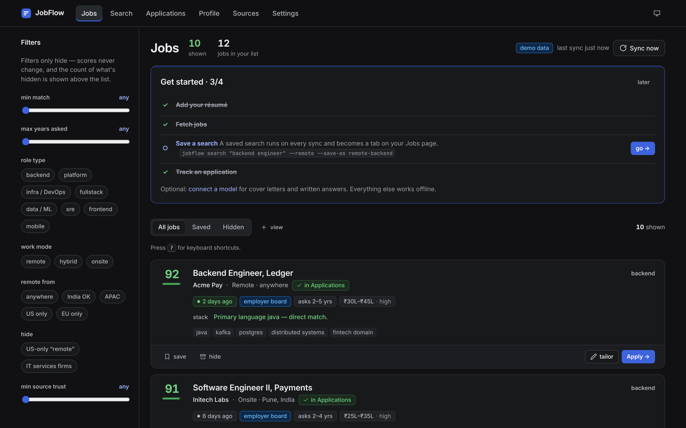

# JobFlow documentation

**Start here:** [Getting started](getting-started.md). It covers cloning, `jobflow init`,
your first sync and search, and the web app.

## Guides

| Guide | What it covers |
|---|---|
| [Web app tour](guides/web-app-tour.md) | Every page, with screenshots: Jobs (filters, saved-search tabs, the checklist), the Job page, Tailor, Search, Applications, Profile, Sources, Settings, onboarding; light/dark; mobile |
| [Daily workflow](guides/daily-workflow.md) | The loop end to end in the CLI and the web app: sync → triage → open → tailor → apply → follow up; saved searches; how freshness works |
| [Your résumé & profile](guides/resume-and-profile.md) | Importing a résumé (and what extraction does and doesn't do), the Evidence Bank, preferences, contact details |
| [Search & discovery](guides/search-and-discovery.md) | Live search and its flags, saved searches, discovery presets and preset tags, your own sources, JSON feed mapping, freshness |
| [Applying](guides/apply.md) | Tailoring, the Apply checklist, the form-filler's review gate, tracking, the local agent, the browser extension |
| [The local agent](guides/local-agent.md) | Optional: pre-fill from the web app, and read logged-in sites (Tier 3) in your own browser; setup and caveats |
| [AI agents (MCP)](guides/ai-agents-mcp.md) | Use JobFlow from Claude Code, Claude Desktop or any MCP client: setup, the single-writer note, the tools / prompts / resources, examples, safety |
| [Keyboard shortcuts](guides/keyboard-shortcuts.md) | `j`/`k`/`o`/`t`/`a`/`s`/`x`/`/`/`?` on Jobs, and the keys elsewhere |
| [LLM providers](guides/llm-providers.md) | Optional models, keys, default models, cost control, honesty rules |
| [Troubleshooting](guides/troubleshooting.md) | A locked data directory, empty syncs and proxies, working without a model, PDFs that won't parse, Chromium, LaTeX, ports, resetting your data, logs |

## Reference

- [CLI reference](cli.md): every `jobflow` command, flag and exit code
- [Configuration reference](configuration.md): every environment variable
- [Architecture](architecture.md): packages, data flow, the tier boundary

## Running it for others

- [Self-hosting for several people](guides/self-hosting.md): accounts, tokens, hardening, licence obligations

## Project

- [Legal & ethics](legal-and-ethics.md): scraping tiers, terms of service, data
- [Contributor guides](contributing/): adding a job source, presets & discovery, the web UI and design system, CLI conventions, data & migrations, testing, releasing
- [Contributing](../CONTRIBUTING.md) · [Security](../SECURITY.md) · [Code of conduct](../CODE_OF_CONDUCT.md) · [Changelog](../CHANGELOG.md)
- [Internal notes](internal/): product plan, original vision and roadmap, UX audit, publishing checklist
- Screenshots: [`screenshots/`](screenshots/). Regenerate them with `pnpm screenshots` (an offline, fictional demo corpus).
