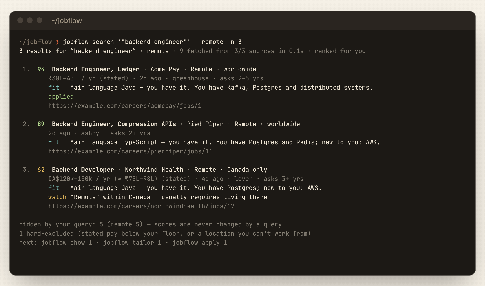
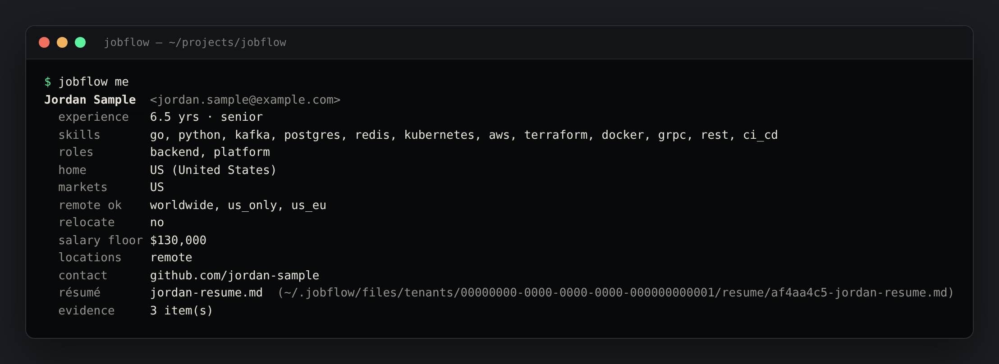
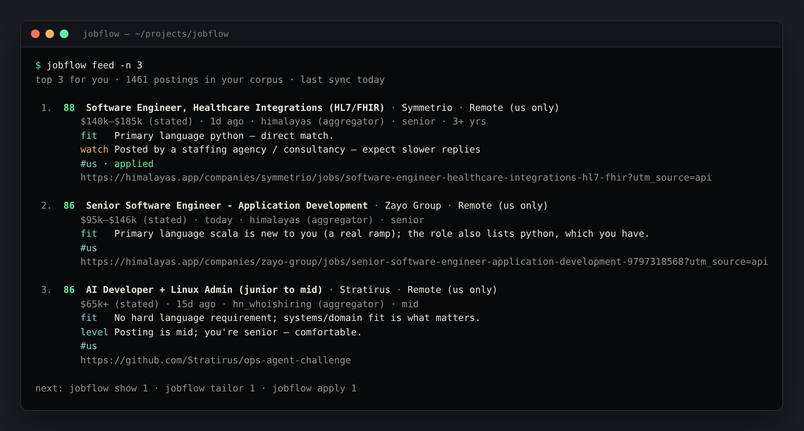
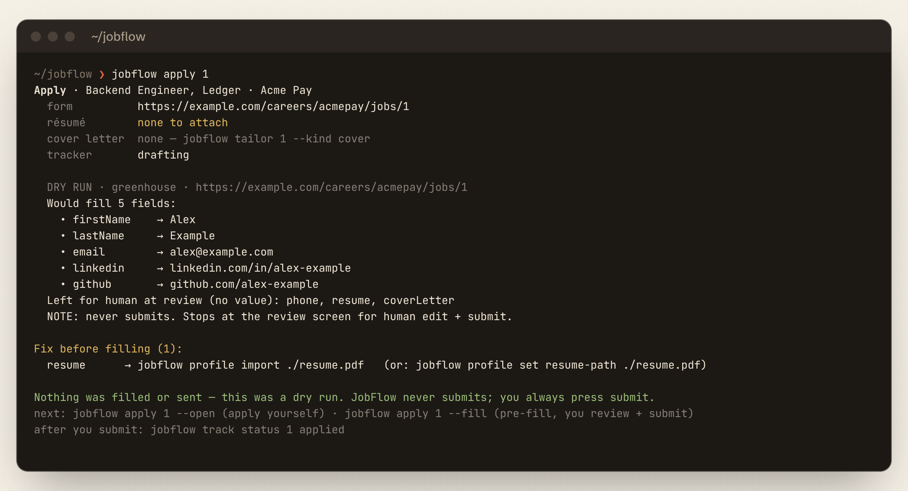
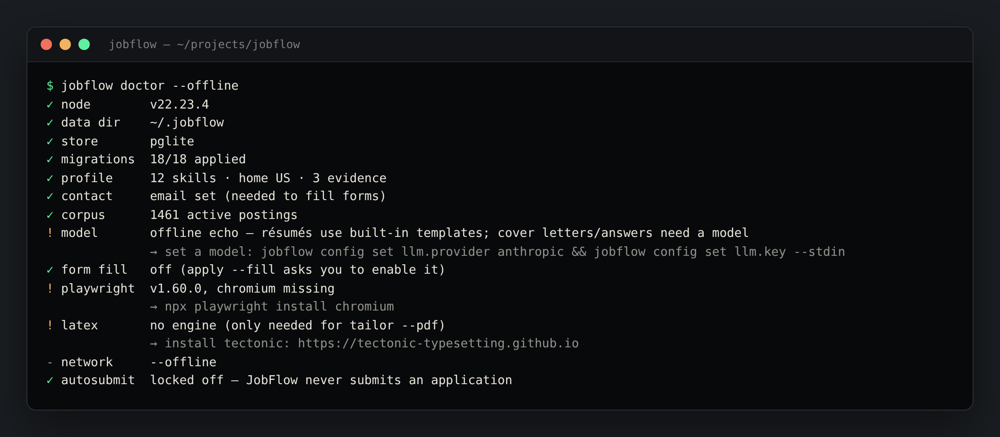

# The `jobflow` CLI



JobFlow on your own machine: set your details once, search live job sources, get honest
match scores, draft grounded résumés and answers, and pre-fill applications up to the
review screen. One person, one machine — no login, no server, no tokens. Everything lives
in a data directory you own (`~/.jobflow` by default).

- [Install](#install)
- [The 5-minute path](#the-5-minute-path)
- [Referring to postings](#referring-to-postings-1-ids-prefixes)
- [Commands](#commands)
- [Your data, privacy, and where the LLM key lives](#your-data-privacy-and-where-the-llm-key-lives)
- [The never-submit guarantee](#the-never-submit-guarantee)
- [Scripting: `--json` and exit codes](#scripting---json-and-exit-codes)

Task-oriented guides: [Daily workflow](guides/daily-workflow.md) ·
[Résumé & profile](guides/resume-and-profile.md) · [Search & discovery](guides/search-and-discovery.md) ·
[Applying](guides/apply.md) · [Troubleshooting](guides/troubleshooting.md).

## Install

```bash
git clone <this repo> jobflow && cd jobflow
pnpm install
pnpm jobflow init
```

That's all: `pnpm jobflow …` runs the TypeScript sources through `tsx` (no build step).
Node 20.11+ and pnpm 9 are required.

Want a plain `jobflow` command on your `PATH`? Either of these links your checkout (so
`git pull` updates it):

```bash
cd apps/cli && pnpm link --global      # then: jobflow --help
# or
npm i -g ./apps/cli
```

> When piping `--json` output through `pnpm`, add `-s` so pnpm's own banner stays out of
> stdout: `pnpm -s jobflow feed --json | jq '.cards[0]'`.

Optional extras, only for the features that need them:

| For | Install |
|---|---|
| `apply --fill` (pre-fill forms in a local browser) | `pnpm add -w playwright && npx playwright install chromium` |
| `tailor --pdf` (compile a résumé PDF locally) | [tectonic](https://tectonic-typesetting.github.io) (or a TeX distribution) |
| Cover letters / answers / tailored résumés | an LLM key — see [config](#jobflow-config) |

`jobflow doctor` tells you what's present and what's missing.

## The 5-minute path

Not sure where you are? Run `pnpm jobflow` on its own: it shows your profile, jobs, saved
searches, applications and model, a getting-started checklist, and the **one** command to
run next.

```bash
pnpm jobflow                                   # where you are + what to do next
pnpm jobflow init                              # résumé → review → preferences → presets
pnpm jobflow sync                              # poll your presets + sources, then rank (≈1–2 min)
pnpm jobflow feed                              # your ranked match cards
pnpm jobflow search "backend engineer" --remote   # or search live, right now
pnpm jobflow show 1                            # the full posting behind row 1
pnpm jobflow tailor 1                          # résumé bullets for it (grounded in YOUR material)
pnpm jobflow tailor 1 --kind cover             # a cover letter (needs a model)
pnpm jobflow apply 1                           # dry run: what would be typed where
pnpm jobflow apply 1 --fill                    # pre-fill it; YOU review and submit
pnpm jobflow track status 1 applied            # once you've actually submitted
```

Just trying it out? `pnpm jobflow init --sample` loads **Alex Example**, a fictional
candidate, instead of your résumé. `pnpm jobflow demo` runs a bounded live end-to-end
pipeline in memory without touching your data at all.

## Referring to postings (`1`, ids, prefixes)

`show`, `tailor`, `apply` and `track` take a posting reference:

- **a row number** from the last listing — `feed`, `search` or `track list`: `3` or `'#3'`
  (quote `#3`: an unquoted `#` starts a comment in most shells);
- **a posting id**, or a **unique id prefix** of 4+ characters (`show` prints the id).

The last listing is remembered in `<data dir>/cli.json`. Search results that aren't in your
corpus yet are kept aside, and the one you pick is saved into your corpus the moment you
`show`/`tailor`/`apply` it — so `search → tailor 2 → apply 2` just works.

## Commands

Global options (anywhere on the line): `--json`, `--data-dir <dir>`,
`--store pglite|memory`, `--no-color`. Every command has `--help`.

### `jobflow` / `jobflow status`

```bash
pnpm jobflow             # status + the next step (the full command list is `jobflow --help`)
pnpm -s jobflow --json   # the same as JSON: steps, next, profile, corpus, searches, applications, model
```

### `jobflow init`

Interactive onboarding. It reads your résumé, shows what it extracted (name, email, skills,
years, level, evidence items) and lets you confirm or edit each field, then asks where and
what you want (home country, markets, remote regions, relocation, salary floor, role types,
locations) and which discovery presets to switch on. Enter keeps the suggested value.

Résumé formats: PDF, DOCX, LaTeX (`.tex`), Markdown, plain text, JSON Resume, a LinkedIn
data-export `.zip`; or type `paste` and paste the text.

Non-interactive (every prompt has a flag):

```bash
pnpm jobflow init --yes --resume ./cv.pdf --home US --markets US,CA \
  --remote worldwide,us_only --floor "150000 USD" --roles backend,platform --preset us
pnpm jobflow init --yes --sample                # the fictional persona
cat cv.txt | pnpm jobflow init --yes --resume -  # résumé text on stdin
```

`--yes` needs something to build a profile from — `--resume`, `--skills` or `--sample`; with
none of them it stops (exit 2) instead of saving an empty profile that every score would then
be invented against. Interactively, skipping the résumé means typing at least one skill.

Other flags: `--name`, `--email`, `--phone`, `--linkedin`, `--github`, `--portfolio`,
`--skills`, `--yoe`, `--level`, `--relocate`/`--no-relocate`, `--locations`, `--assist`
(also run the grounded LLM-assisted extraction), `--force`.

Nothing from the résumé is saved until you confirm it, and nothing is inferred beyond what
the file says.

### `jobflow me` / `jobflow profile`

```bash
pnpm jobflow me                                   # your profile + what's still missing
pnpm jobflow profile set email sam@example.com
pnpm jobflow profile set name "Sam Placeholder"
pnpm jobflow profile set skills "go,postgres,kafka"   # replace
pnpm jobflow profile set skills +rust                  # add   (-java removes)
pnpm jobflow profile set home US
pnpm jobflow profile set markets US,CA
pnpm jobflow profile set remote worldwide,us_only
pnpm jobflow profile set floor "150000 USD"            # 0 clears it
pnpm jobflow profile set resume-path ~/cv/tailored.pdf
pnpm jobflow profile import ./cv-2026.pdf [--merge] [--assist]
pnpm jobflow profile edit                              # $EDITOR on a JSON of your profile
```



Fields for `set`: `name first last email phone linkedin github portfolio resume-path
skills must-haves roles yoe level home markets remote relocate floor currency locations
about` (`pnpm jobflow profile set --help` explains each). Skills are mapped to canonical
names where known (`PostgreSQL` → `postgres`); unknown ones are kept as typed and reported.
`profile edit` validates against the same schema the app uses before saving. After changing
anything that affects matching, re-score with `jobflow rank`.

### `jobflow evidence`

The Evidence Bank: concrete things you did, in your words. Every generated bullet, answer
or letter must rest on this, your résumé, or your declared skills — so real entries here
make drafts better.

```bash
pnpm jobflow evidence                              # list
pnpm jobflow evidence add --project "Example Corp" --headline "Built a Go ingestion service" \
  --detail "10k events/s on Postgres + Kafka" --metric "10k events/s" --tags go,kafka
pnpm jobflow evidence rm 2                          # by number, id or id prefix
```

### `jobflow config`

```bash
pnpm jobflow config                                  # list (the key is masked)
pnpm jobflow config set llm.provider anthropic       # echo | anthropic | openai | grok
printf %s "$ANTHROPIC_API_KEY" | pnpm jobflow config set llm.key --stdin
pnpm jobflow config set llm.model <model-id>         # optional override
pnpm jobflow config set llm.baseUrl <url>            # optional gateway / local server
pnpm jobflow config set automation.fill on           # allow apply --fill (it never submits)
pnpm jobflow config set automation.rate human        # human (default) | fast
pnpm jobflow config set discovery.presets us,eu-uk
pnpm jobflow config set display.currency USD         # show pay in: auto (home currency) | none | USD, EUR, INR, …
pnpm jobflow config set display.payPeriod month      # the converted figure per year (default) | month
pnpm jobflow config get llm.key                      # ••••abcd
pnpm jobflow config unset llm.key
```

On a terminal, `config set llm.key` with no value prompts with hidden input. Passing the
key as an argument works but warns: it ends up in your shell history.

### `jobflow search`

Live search across the search-capable public sources, scored against your profile with the
same scorer as the feed. Your query is a **view**: what it hides is counted and reported,
and it never changes a score.

```bash
pnpm jobflow search "backend engineer" --remote
pnpm jobflow search "staff platform" --loc "Berlin,DE" --seniority staff --min-salary "120000 EUR"
pnpm jobflow search backend --min-salary "40L INR" --sort pay   # highest pay first, in one currency
pnpm jobflow search sre --min-salary "5000 EUR/mo"              # periods are annualised (×12)
pnpm jobflow search golang --must kafka --posted 7d --save-as go-kafka
pnpm jobflow search backend --preset us,eu-uk       # only roles tagged #us / #eu-uk
pnpm jobflow search "data engineer" --ingest         # also add the results to your feed
```

`--min-salary` reads amounts the way postings are read: `"150k USD"`, `"$120k"`, `"40L INR"`,
`"30 LPA"`, `"5000 EUR/mo"`, `"€50/hr"`. It hides only roles whose stated, high-confidence
ceiling is below it — in another currency only when still below after the exchange rate's
margin of error. `--sort pay` orders by annual pay converted to your display currency (stated
pay first, else the estimate's median).

Flags: `--remote`, `--onsite`, `--loc <place>` (repeatable), `--country <CC>`,
`--seniority`, `--min-salary`, `--currency`, `--posted 7d|2w|1m`, `--sources a,b`,
`--must`, `--nice`, `--title`, `--exclude-company`, `--exclude`, `--preset`/`--tag`,
`-n/--limit` (15), `--sort score|relevance|pay`, `--format cards|table`, `--save-as <name>`,
`--ingest`.

Before `init` the results are **unscored**: no score, no notes about "your stack" or level,
and nothing hard-excluded — there's no profile to judge them against yet.

Each card shows the score, title, company, location, pay (stated, or a labelled estimate
with its confidence), age, source, stack fit, level note, red flags, preset tags and the
apply link. A search writes nothing to your corpus unless you `--ingest` or pick a result.
Sources that don't answer (network down, a site blocking you) are reported, not fatal.

### `jobflow searches`

Saved searches run on every `sync` and double as feed views.

```bash
pnpm jobflow searches                                         # list
pnpm jobflow searches add go-remote golang --remote --seniority senior
pnpm jobflow searches add berlin "platform" --loc "Berlin,DE" --no-source   # a view only (fetches nothing)
pnpm jobflow searches run go-remote
pnpm jobflow feed --search go-remote
pnpm jobflow searches rm go-remote
```

### `jobflow discovery` / `jobflow sources`

What `sync` polls: the built-in presets you switch on, plus your own sources. A preset is
also a **tag** you can filter by (`search --preset`, `feed --preset`).

```bash
pnpm jobflow sources                         # presets on, their feeds, your sources
pnpm jobflow discovery presets               # all presets, on/off
pnpm jobflow discovery use india,global-remote   # exactly these
pnpm jobflow discovery preset-on us
pnpm jobflow discovery preset-off india
pnpm jobflow discovery add-rss https://example.com/jobs.rss [--company "Example"]
pnpm jobflow discovery add-json https://example.com/jobs.json [--map mapping.json]
pnpm jobflow discovery add-telegram some_jobs_channel
pnpm jobflow discovery add-hn                # the latest "Who is hiring" each month
pnpm jobflow discovery add-company https://jobs.example.com/careers   # ATS detected
pnpm jobflow discovery import-companies companies.csv   # name,careers_url columns
pnpm jobflow discovery disable 2             # a source (number/id) or a preset feed id
pnpm jobflow discovery enable 2
pnpm jobflow discovery rm 2
```

Every URL you add must be public `https`; it's checked before it's saved. Everything is
public data — logged-in sites (LinkedIn, Naukri, Glassdoor) are only ever read by the local
agent in your own browser session, never by `sync`.

### `jobflow sync` / `jobflow rank`

```bash
pnpm jobflow sync           # every due board within ~5 minutes (the first sync: 25 boards), then rank
pnpm jobflow sync --max-boards 40   # cap this run (or JOBFLOW_SYNC_MAX_BOARDS)
pnpm jobflow sync --full    # every due board and slow feed, no time limit — takes a while
pnpm jobflow rank           # re-score only (after a profile change)
pnpm jobflow renormalize    # re-parse stored postings' locations + agency flags (no polling), then rank
```

Progress goes to stderr, so stdout stays data:

- **In a terminal**: a live two-line display (step, bar, boards `n/N`, failures, jobs fetched
  and new, time left; then the boards being fetched).
- **Not a terminal** (CI, a pipe, a log file): plain lines, one when each step starts and
  ends, plus the board count every 10%.
- **`--json`**: one JSON object per line on stderr (`{"type":"sync.progress","phase":…,
  "boards":{…},"postings":{…},"etaMs":…}`), at each step change and at most twice a second.
  stdout is still one summary document: the poll stats plus `status`, `newPostings`,
  `newMatches` (score 60+), `strongMatches` and the whole `run` (steps, counts, errors).

The summary says how many new matches score 60 or more for you. Ctrl-C cancels cleanly: no
new boards start, everything fetched is kept and ranked, nothing is retired from the partial
run, and the exit code is 130. A second Ctrl-C quits at once. The run is recorded in your
data, so the web app's **Sources → Recent syncs** shows terminal syncs too.

Re-polling is idempotent; postings that disappeared from their board are retired, and
aggregator postings expire when nobody re-confirms them. After an upgrade that improves the
location parser, the next `sync` re-parses the postings you already hold once (from their
stored location text) before polling; `renormalize` does the same on demand and prints what
changed.

### `jobflow feed` / `jobflow show`

```bash
pnpm jobflow feed                          # top 20
pnpm jobflow feed -n 50 --min-score 70 --format table
pnpm jobflow feed --search go-remote       # through a saved search (hidden counts shown)
pnpm jobflow feed --preset india           # only #india roles
pnpm jobflow feed --no-diversify           # strictly by score (see below)
pnpm jobflow show 3 [--jd]                 # details, fit, tracker status, drafts, "ready?" + next commands
```

By default no single company fills the page: at most 3 of its jobs in any 20 cards, the rest
following further down — but a held-back job never lands below jobs scoring more than 12
points less, and the company's last card on the page says "+N more at <company> further
down". That only changes the order; every card keeps its real score and nothing is hidden. `--no-diversify` lists strictly by score (the web app's **score order
only** chip under Filters → order; MCP `list_jobs` takes `diversify: false`).



Before you've set up a profile the feed is a **browse** feed — freshest postings, no
scores. JobFlow never shows a fit score it can't back.

### `jobflow tailor`

```bash
pnpm jobflow tailor 1                                   # résumé bullet variants
pnpm jobflow tailor 1 --kind resume-md --out cv.md
pnpm jobflow tailor 1 --kind resume-latex --pdf         # compile + attach to the application
pnpm jobflow tailor 1 --kind cover --note "I use your product daily"
pnpm jobflow tailor 1 --kind why-here
pnpm jobflow tailor 1 --kind answer --question "Describe a hard bug you fixed"
```

Kinds: `resume`, `resume-md`, `resume-latex`, `cover`, `why-here`, `problem`, `about`,
`answer`. Drafts are cached and marked stale when your profile, evidence, model or the
posting changes; `--force` regenerates.

Without a model (the default offline `echo` provider), résumés fall back to a deterministic
template built from your own résumé and are labelled **builtin**; cover letters and answers
refuse (exit 4) instead of passing an echo off as writing:

```
error: Writing a cover letter needs a generation model — the offline echo provider can't write prose.
set a model: jobflow config set llm.provider anthropic && jobflow config set llm.key --stdin
```

Letters and answers are saved onto the posting's application (unless `--no-attach`), so
`apply --fill` types them into the form. `--pdf` attaches the compiled PDF to this
application only — tailoring role B never replaces role A's file.

### `jobflow apply`

```bash
pnpm jobflow apply 1           # dry run: form URL, résumé file, cover letter, field-by-field plan
pnpm jobflow apply 1 --open    # open the form in your default browser
pnpm jobflow apply 1 --fill    # pre-fill it in a local browser, then STOP for your review
```



The dry run also lists anything to fix first (no email, no résumé file to attach…) with the
exact command to fix it. It moves the posting forward in your tracker: **ready** when nothing
is missing, otherwise **drafting** with the fix as its next step. Nothing is filled or sent by
a dry run.

`--fill` needs Playwright + Chromium and a one-time `jobflow config set automation.fill on`
(an explicit `JOBFLOW_BROWSER=off` in the environment always wins). It opens the form in a
persistent browser profile (`<data dir>/browser-profile`, or `--browser-profile <dir>` /
`JOBFLOW_BROWSER_PROFILE`), types only values you stored, attaches your tailored PDF or base
résumé, and stops. You check every field, fix what's wrong, and press submit yourself; then
press Enter in the terminal. It asks whether you submitted, and only a "yes" marks the
application **applied**.

### `jobflow track`

```bash
pnpm jobflow track                                  # list, next actions first (numbers are refs)
pnpm jobflow track list --status interviewing
pnpm jobflow track add 3
pnpm jobflow track status 2 applied
pnpm jobflow track status 2 interviewing --note "Onsite next week"
pnpm jobflow track next 2 "Send take-home" --due 2026-12-01
```

Statuses: `saved drafting ready applied screening interviewing offer rejected withdrawn
ghosted`.

### `jobflow doctor`

Checks Node, the data dir and store, migrations, profile readiness, contact email, corpus
size, the model (with a one-token test call — skip with `--offline`), Playwright +
Chromium, a LaTeX engine, network reachability of two public job-board APIs, and that
autosubmit is locked off. Exits 1 if anything fails; `--json` for machines.



If something is wrong, [Troubleshooting](guides/troubleshooting.md) covers each failure.

### `jobflow serve`

```bash
pnpm jobflow serve [-p 3000] [--dev]
```

Starts the web UI on the **same** data (`next start` if the web app is built, else
`next dev`). The local database is single-writer: while `serve` runs it holds the data
dir, and other `jobflow` commands stop with a clear message pointing at the running UI
instead of risking your data. Ctrl-C stops the server (and its whole process tree).

The UI's pages mirror the commands: **Jobs** (`/`, like `jobflow feed`), **Search**
(`/search`, `jobflow search`), **Applications** (`/applications`, `jobflow track`),
**Profile** (`/profile`, `jobflow init` / `jobflow profile`), **Sources** (`/sources`, `jobflow
discovery` and `jobflow sync`) and **Settings** (`/settings`, `jobflow config`). Each job has
a Job page at `/jobs/<id>` with the apply checklist (`jobflow apply`). The old `/searches` and
`/discovery` addresses redirect to `/search` and `/sources`. A tour of every page is in
[the web app tour](guides/web-app-tour.md).

### `jobflow mcp`

```bash
pnpm jobflow mcp [--idle 20]
claude mcp add jobflow -- node /path/to/jobflow/apps/cli/bin/jobflow.mjs mcp
```

Serves JobFlow to AI agents (Claude Code, Claude Desktop, any MCP client) over the Model
Context Protocol on stdin/stdout. Your MCP client starts it; you don't run it by hand. It
offers tools for search, the ranked feed, one job in full, saved searches, the tracker, a
dry-run apply plan and grounded drafts, plus two prompts and two resources. Nothing it exposes
fills or sends a form: to pre-fill, you run `jobflow apply <id> --fill` yourself.

It uses the same data as every other command (`--data-dir`, `--store`, `DATABASE_URL`). Since
stdout is the protocol channel, its only log line goes to stderr. It doesn't hold the
single-writer database while the agent sits idle: the database is opened per tool call and
released after `--idle` seconds (default 20), so other `jobflow` commands keep working. While
`jobflow serve` holds the data, its tools return a clear error instead. Setup, the tool
reference and examples are in [AI agents (MCP)](guides/ai-agents-mcp.md).

### `jobflow demo` / `jobflow harvest`

- `jobflow demo` — a bounded live run of the whole pipeline (discover → poll → rank → match
  cards → re-rank narrative → tailoring → autofill dry run) with the fictional persona, in
  memory. Same as `pnpm demo`.
- `jobflow harvest --telegram chanA,chanB` / `--whatsapp ./chat.txt` — pull ATS/careers
  links out of community channels and register those companies' boards for the next sync.

## Your data, privacy, and where the LLM key lives

Everything is in one directory: `--data-dir`, else `$JOBFLOW_DATA_DIR`, else `~/.jobflow`
(created with owner-only permissions, and never inside the repo, so nothing personal can
be committed by accident):

| Path | What |
|---|---|
| `pgdata/` | the database (PGlite — Postgres compiled to WebAssembly, same schema and migrations as the server) |
| `files/` | your uploaded résumé and tailored PDFs |
| `browser-profile/` | the browser profile `apply --fill` uses (your site logins) |
| `cli.json` | the last listing, for row-number references |
| `.env` | optional per-install environment (loaded after the repo-root `.env`) |
| `.lock`, `server.json` | the single-writer lock; which `serve` holds it |

- **The LLM key** is stored in your settings row in that database (`config set llm.key`),
  encrypted at rest if `JOBFLOW_SECRET_KEY` is set. It is only ever printed masked. A key in
  the environment (`ANTHROPIC_API_KEY` etc. with `LLM_PROVIDER`) also works on a
  single-user install.
- **What leaves your machine:** requests to public job APIs (searches and syncs), and —
  only if you configure a model — your résumé/evidence text and the posting, sent to the
  provider you chose, to write a draft. Nothing else; there is no JobFlow server.
- `--store memory` runs without persisting anything; `DATABASE_URL` points the CLI at a
  Postgres server instead (it wins over PGlite).
- Delete the directory to delete everything.

## The never-submit guarantee

JobFlow never submits an application.

- There is **no `--submit` option** and no command that submits; a test walks the whole
  command tree and fails if any command or option mentions submitting.
- The form-filler has no code path that clicks submit or sends a form. `autosubmit` is
  hard-wired to `false`, `assertNeverSubmits()` throws if it ever isn't, and `doctor`
  reports the lock.
- `apply --fill` stops at the review screen. An application becomes **applied** only when
  you say so (`track status … applied`, or "yes" at the end of `--fill`).

## Scripting: `--json` and exit codes

Every command accepts `--json` and prints one JSON document on stdout; progress and hints
go to stderr. Exit codes:

| Code | Meaning |
|---|---|
| 0 | ok |
| 1 | error (network, a failed compile, data dir busy, `doctor` found a failure) |
| 2 | usage (bad flag or value, unknown command/field/preset, ambiguous id prefix) |
| 3 | not found (no such posting / row / saved search / evidence item / file) |
| 4 | needs setup (no profile yet, no generation model, form filling off, Playwright missing) |

```bash
pnpm -s jobflow --json search "sre" --remote -n 5 | jq -r '.cards[] | "\(.score) \(.title) @ \(.company)"'
```
