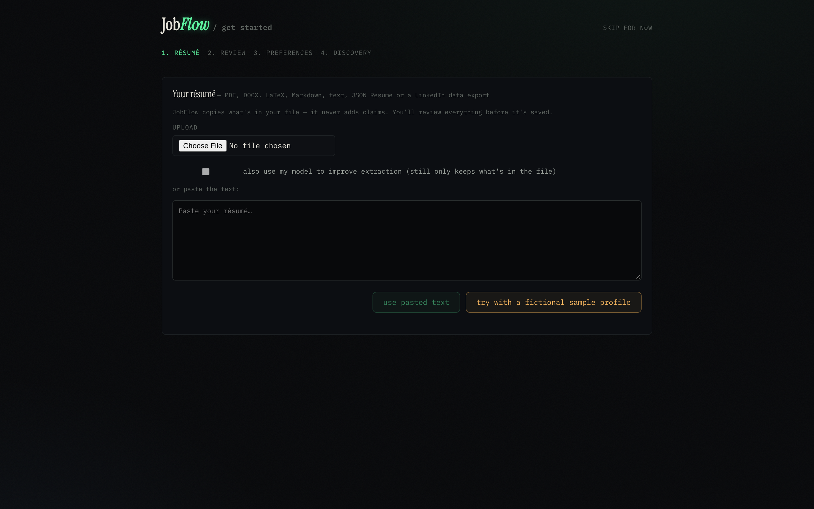
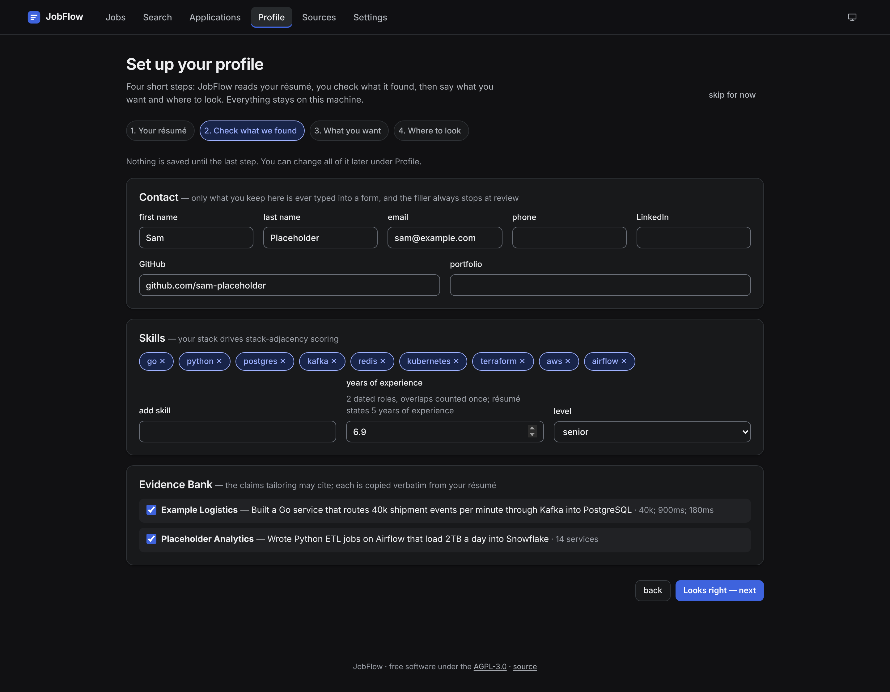
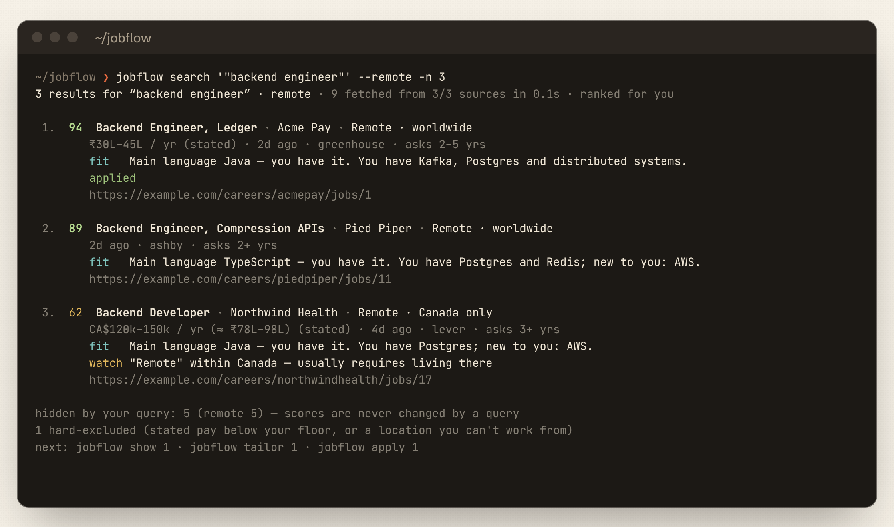
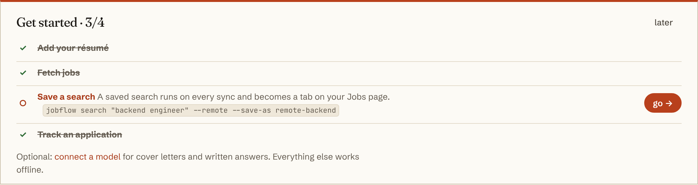
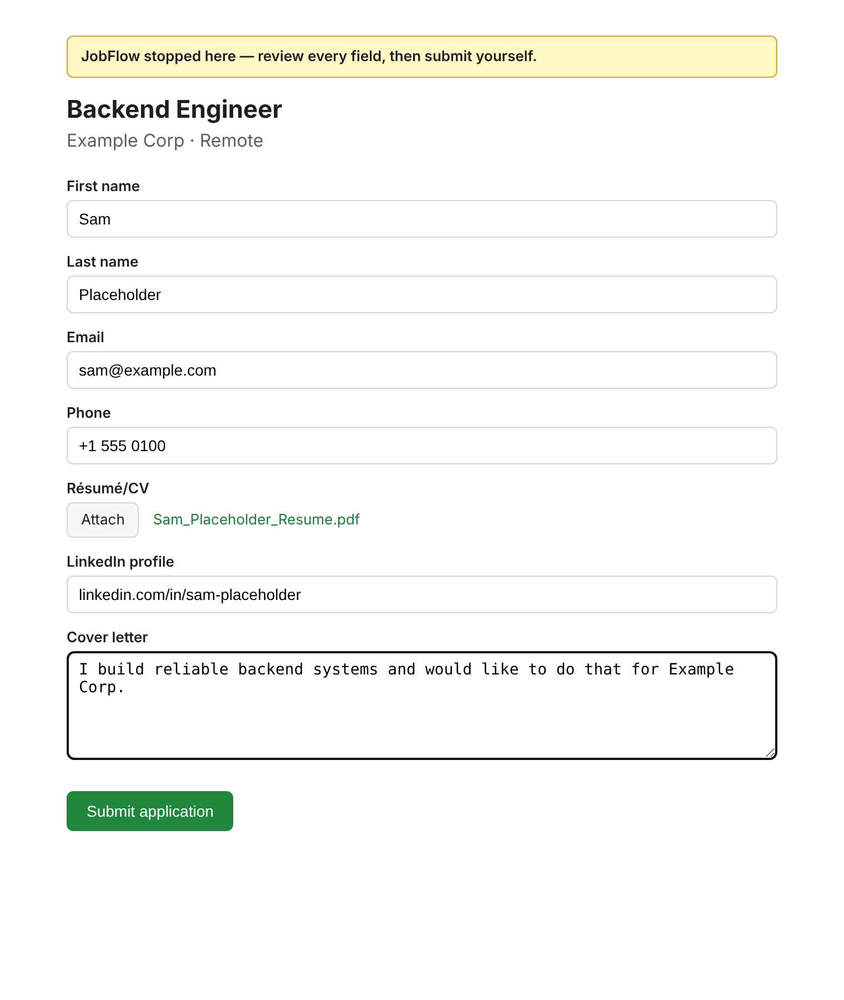
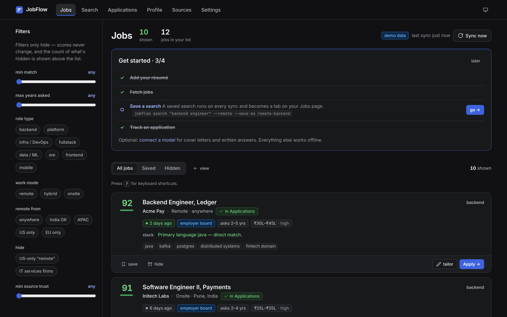

# Getting started

JobFlow runs on your own machine. Clone it, tell it who you are, and search. No account,
no server, no API keys needed to start.

**Requirements:** Node 20.11+ (22 recommended) and pnpm 9 (`corepack enable`).

```bash
git clone https://github.com/jagritvats/jobflow.git
cd jobflow
pnpm install
pnpm -r build
```

## 1. Tell JobFlow who you are

```bash
pnpm jobflow          # where you are and what to do next — run it any time
pnpm jobflow init
```

`init` asks for your résumé (PDF, DOCX, LaTeX, Markdown, text, JSON Resume or a LinkedIn
data export), shows what it extracted — contact details, skills, years of experience,
level, and the bullet points that become your **Evidence Bank** — and lets you correct
it. Then it asks where you want to work (home country, markets, remote regions, relocation),
your salary floor, the kinds of roles you want, and which built-in discovery presets to start
from (India, Global remote, United States, Europe & UK — pick several if you like).

Nothing is invented: every claim JobFlow will ever make for you comes from what you
confirmed here. Prefer flags? `pnpm jobflow init --yes --resume ./cv.pdf --home US
--markets US,CA --remote worldwide,us_only --floor "150000 USD" --roles backend,platform
--preset us,global-remote`. Just exploring? `pnpm jobflow init --sample` loads a fictional candidate.

Prefer a browser? Run `pnpm jobflow serve` and open http://localhost:3000. The first visit
starts the same setup as a four-step onboarding: **Your résumé → Check what we found → What
you want → Where to look**.

<p>
  
  
</p>

Your data lives in `~/.jobflow` (override with `JOBFLOW_DATA_DIR`): a local database,
your uploaded résumé and generated documents. Nothing leaves your machine except requests
to public job boards and, if you configure one, your LLM provider.

Change details any time:

```bash
pnpm jobflow profile set email you@example.com
pnpm jobflow profile set skills "go,postgres,kafka"
pnpm jobflow profile show
```

## 2. Search

```bash
pnpm jobflow search "backend engineer" --remote --posted 7d
pnpm jobflow search "staff platform" --loc Berlin,DE --seniority senior,staff
```

`search` asks the job boards that support search right now and scores every result against
your profile — the same honest score as the feed: why it fits, the likely gap, stack
distance, and red flags such as a "remote" role that's actually US-only. Filters like
`--loc` or `--seniority` hide only what is *known* not to match and always tell you how
many they hid.

Keep a search running: `pnpm jobflow search "backend engineer" --remote --save-as remote-backend`.



## 3. Build your feed

```bash
pnpm jobflow sync      # discover companies + poll boards and feeds, then rank
pnpm jobflow feed      # your ranked match cards
pnpm jobflow show '#1' # one card in full, with the job description
```

`sync` polls the companies and boards in your discovery preset, your own sources (add RSS
feeds, Telegram channels, companies… with `jobflow discovery`), and your saved searches. The
first one takes a minute or two. If it brings back nothing, see
[Troubleshooting](guides/troubleshooting.md#a-sync-finished-but-there-are-no-jobs).

In the web app, the first sync starts by itself after onboarding, and the Jobs page fills in
when it's done. Until you've done the basics, a **Get started** checklist sits on top:



## 4. Tailor and apply

```bash
pnpm jobflow tailor '#1'                 # résumé variants grounded in YOUR material
pnpm jobflow tailor '#1' --kind cover    # needs an LLM (see below)
pnpm jobflow apply '#1'                  # what would be filled where — a dry run
pnpm jobflow apply '#1' --open           # open the application page
pnpm jobflow apply '#1' --fill           # fill it in your browser, then YOU review and submit
pnpm jobflow track status '#1' applied
```

`--fill` uses Playwright in a browser profile on your machine. Set it up once with
`pnpm add -w playwright && npx playwright install chromium`, then
`pnpm jobflow config set automation.fill on`. It **never submits**: there's no option for it
and no code path that does. See [Applying](guides/apply.md).



## Add an LLM (optional)

Everything above works offline. A model makes match write-ups richer and is required for
prose (cover letters, application answers):

```bash
pnpm jobflow config set llm.provider anthropic   # or openai, grok
pnpm jobflow config set llm.key --stdin          # paste the key; it never lands in shell history
pnpm jobflow doctor                              # checks everything
```

See [guides/llm-providers.md](guides/llm-providers.md).

## The web app

Prefer a UI? `pnpm jobflow serve` opens the same data in the browser at
http://localhost:3000. It only answers on localhost.

| Page | What it's for |
|---|---|
| **Jobs** | your ranked jobs; a tab per saved search; Saved and Hidden; a "get started" checklist until you're set up. Keys: `j`/`k` move, `o` open, `t` tailor, `a` apply, `s` save, `x` hide, `/` search, `?` help ([all keys](guides/keyboard-shortcuts.md)) |
| **Search** | ask the live boards now; save a search to make it a Jobs tab |
| **Applications** | to apply / in progress / closed, next steps and due follow-ups |
| **Profile** | résumé, contact, skills, what you want, Evidence Bank |
| **Sources** | presets, your own sources (with last-run status), Sync now; "All companies" lists every company it polls |
| **Settings** | writing model, applying & the local agent, data, API tokens |

Click a job's title for its **Job page**: how you fit, the full description, your drafts, and
the Apply checklist (open the form, pre-fill it, or mark it applied). On a narrow screen the
Jobs filters open from a **Filters** button; the theme toggle in the header switches between
system, light and dark.



Every page, with screenshots, is in the [web app tour](guides/web-app-tour.md).

## Docker

For an always-on setup (Postgres + web app + a worker that polls every 6 hours):

```bash
cp .env.example .env    # optional: add an LLM key
pnpm docker:up          # web → http://localhost:3000
```

Everything binds to `127.0.0.1`. Hosting JobFlow for other people is a different mode —
see [guides/self-hosting.md](guides/self-hosting.md).

## Next

- [Daily workflow](guides/daily-workflow.md): the loop you'll run every day, in the CLI and the web app
- [Web app tour](guides/web-app-tour.md): every page, themes, mobile
- [Your résumé & profile](guides/resume-and-profile.md) · [Search & discovery](guides/search-and-discovery.md) · [Applying](guides/apply.md)
- [Keyboard shortcuts](guides/keyboard-shortcuts.md) · [LLM providers](guides/llm-providers.md) · [The local agent](guides/local-agent.md) · [Troubleshooting](guides/troubleshooting.md)
- [CLI reference](cli.md) · [Configuration reference](configuration.md) · [Legal & ethics](legal-and-ethics.md)
- Running it for others: [Self-hosting](guides/self-hosting.md)
