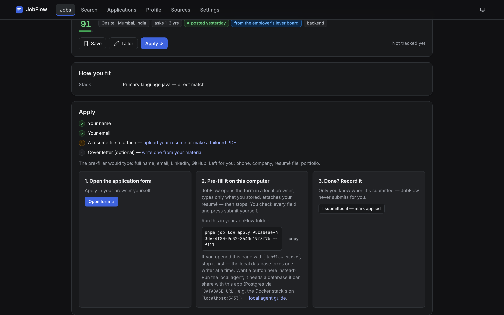
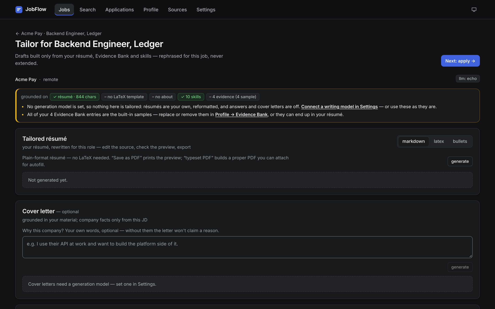
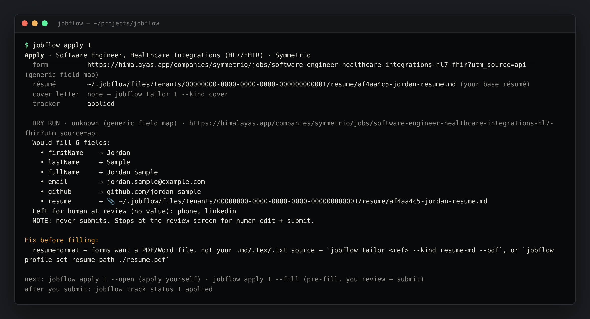
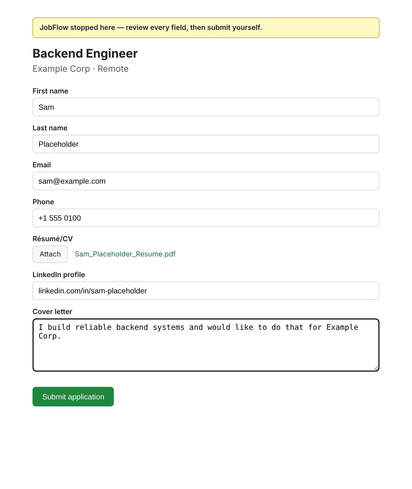
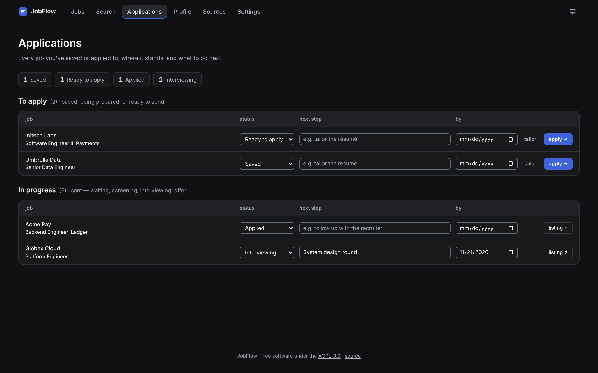

# Applying

JobFlow helps you apply well — tailored, grounded documents and a pre-filled form — and then
**stops**. You review every field and click submit yourself. That isn't a missing feature;
it's the point: what goes out in your name should be something you've read.

## From the web app

Every job has a **Job page**. Click its title, or press `o` on the Jobs page (`a` jumps
straight to the Apply panel). Its **Apply** panel is a checklist: your name, your email, a
résumé file to attach, and an optional cover letter. Anything missing gets a fix link. Below
the checklist, a line says what the pre-filler would type and what it leaves for you. Then
there are three options:



1. **Open the application form**: apply in your browser yourself.
2. **Pre-fill it on this computer**: shows the exact `pnpm jobflow apply <id> --fill` command
   to run, with a copy button. Stop `jobflow serve` first, because the local database takes one
   writer at a time. If the local agent is running (below), this is a **Pre-fill with the local
   agent** button instead.
3. **Done? Record it**: **I submitted it — mark applied**. Then add a next step and a
   follow-up date; it appears under Applications when it's due.

**Tailor** (from a card, the Job page, or `t` on Jobs) drafts a résumé (Markdown, LaTeX or
bullet variants), a cover letter, and answers to "Why do you want to work here?" and "An
interesting problem you've solved". A **grounded on** strip shows what the drafts can draw on.
Each draft says where it came from: *from your résumé (template)* without a model, or
*written by <model>*.

- **use for autofill** attaches the résumé you made to this job's application.
- **Save to application** attaches your letter, answers and chosen bullets, so the
  form-filler types them.
- **Next: apply →** takes you back to the Apply panel.



See the [web app tour](web-app-tour.md#tailor) for every Tailor control.

## From the CLI

```bash
pnpm jobflow tailor '#1'                    # résumé bullet variants for this posting
pnpm jobflow tailor '#1' --kind resume-latex --pdf --out cv.pdf   # needs tectonic for --pdf
pnpm jobflow tailor '#1' --kind cover --note "I use your product daily"
pnpm jobflow apply '#1'                     # dry run: the fill plan + which résumé file
pnpm jobflow apply '#1' --open              # open the application in your browser
pnpm jobflow apply '#1' --fill              # fill it in a local browser, then stop for review
pnpm jobflow track status '#1' applied      # once YOU have submitted
```

The dry run lists anything to fix first (no email, no résumé file…) with the command that
fixes it, and moves the job forward in your tracker: **ready** when nothing is missing,
otherwise **drafting**. Letters and answers from `tailor` are saved onto the job's
application (unless `--no-attach`), so `--fill` types them. `--pdf` attaches the compiled PDF
to this application only.

`--fill` needs Playwright once:

```bash
pnpm add -w playwright
npx playwright install chromium
```

Form filling is off by default; switch it on once with `pnpm jobflow config set automation.fill on`.

It opens the form in a persistent browser profile under `~/.jobflow/browser-profile`
(log in to sites there once if they need it), types only the contact details and answers
you stored, attaches your tailored résumé (or base résumé), and waits. You check every field
and press submit yourself, then press Enter in the terminal. It asks whether you submitted,
and only a "yes" marks the application **applied**. If it won't start, see
[Troubleshooting](troubleshooting.md#apply---fill-wont-start). Greenhouse, Lever,
Ashby, Workable and Workday forms have dedicated field maps; anything else gets a cautious
generic map.





### Guarantees

- There is **no submit option** and no code path that clicks submit, presses Enter on a
  form or dispatches a submit event. `JOBFLOW_AUTOSUBMIT` is hard-wired to `false`, and
  `assertNeverSubmits()` throws if it isn't. Tests enforce this.
- Only stored values are typed. Nothing is generated at fill time.
- Prose (cover letters, answers) requires a real model and is grounded in your résumé and
  Evidence Bank; with the offline `echo` provider, documents fall back to your own résumé
  reformatted (labelled `builtin`) and prose refuses rather than inventing.

## Tracking

```bash
pnpm jobflow track                                   # next actions first; row numbers are refs
pnpm jobflow track add '#3'
pnpm jobflow track status '#3' interviewing --note "Onsite next week"
pnpm jobflow track next '#3' "Send thank-you" --due 2026-12-01
```

In the web app, **Applications** groups everything into To apply, In progress and Closed,
with a status, next step and date on each row. **Follow-ups due** sits on top.



The feed marks postings you've already tracked or applied to, so you don't apply twice. The
whole loop is in [Daily workflow](daily-workflow.md).

## The local agent

The optional **local agent** runs on your machine, in your browser profile. While it's
online, the Job page's Apply panel gets a **Pre-fill with the local agent** button. It's also
the only part of JobFlow that reads logged-in sites (LinkedIn, Naukri, Glassdoor,
AmbitionBox). It's off by default, and turning it on takes Postgres (the Docker stack is
enough), environment flags, a Settings opt-in and a running process. See **[The local agent](local-agent.md)** for the steps and the
caveats.

## Browser extension

The MV3 extension (`apps/extension`) adds a match panel to job pages you're viewing and a
"capture" button that saves the posting to your feed. It's read-only — it never fills or
submits. Load it unpacked from `chrome://extensions` (Developer mode → Load unpacked →
`apps/extension`); by default it talks to `http://localhost:3000` (`jobflow serve`), and its
options page lets you point it at another server with an API token.
