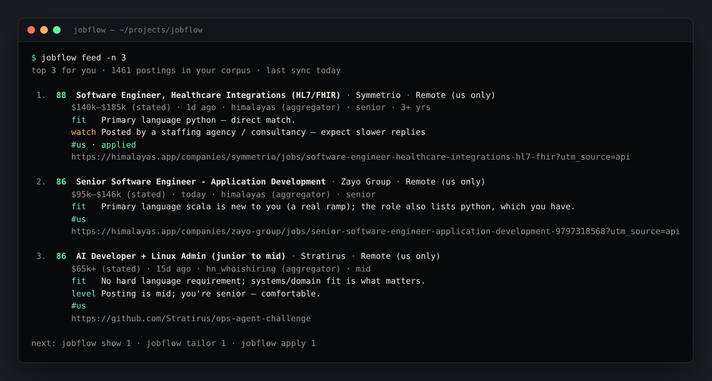
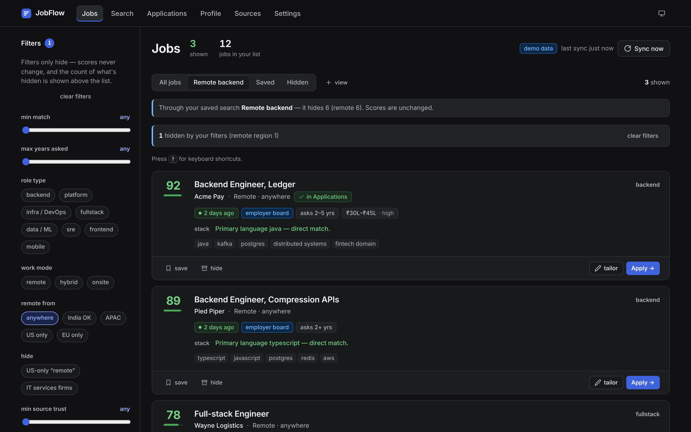
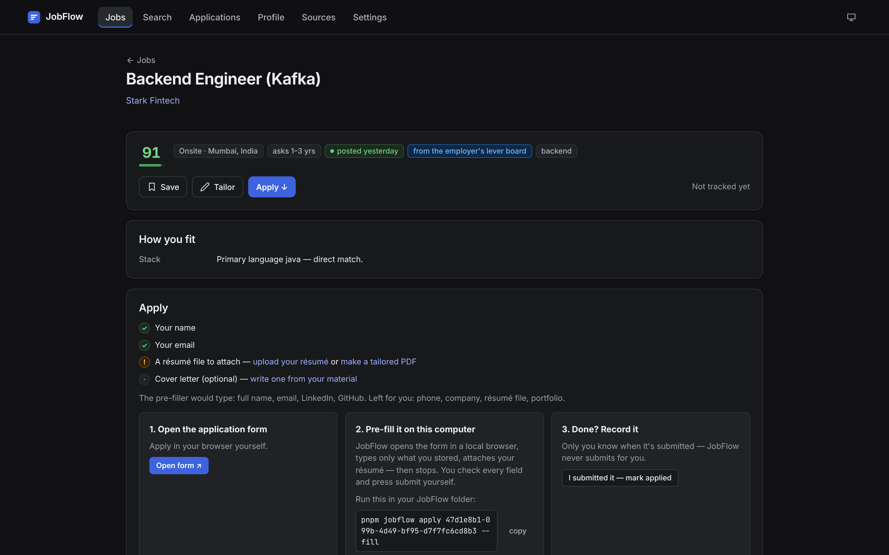
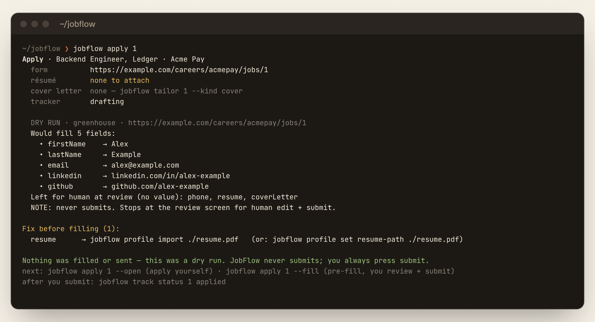
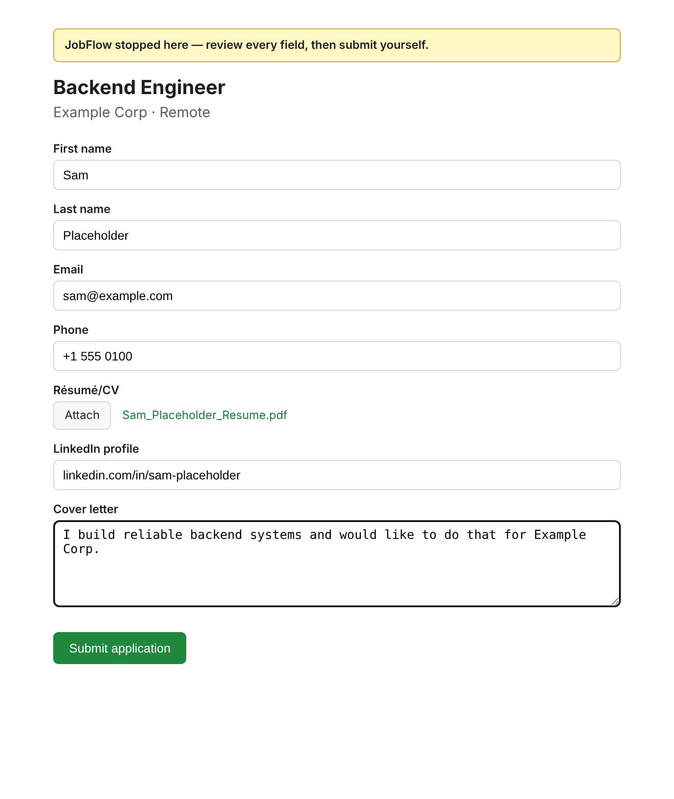
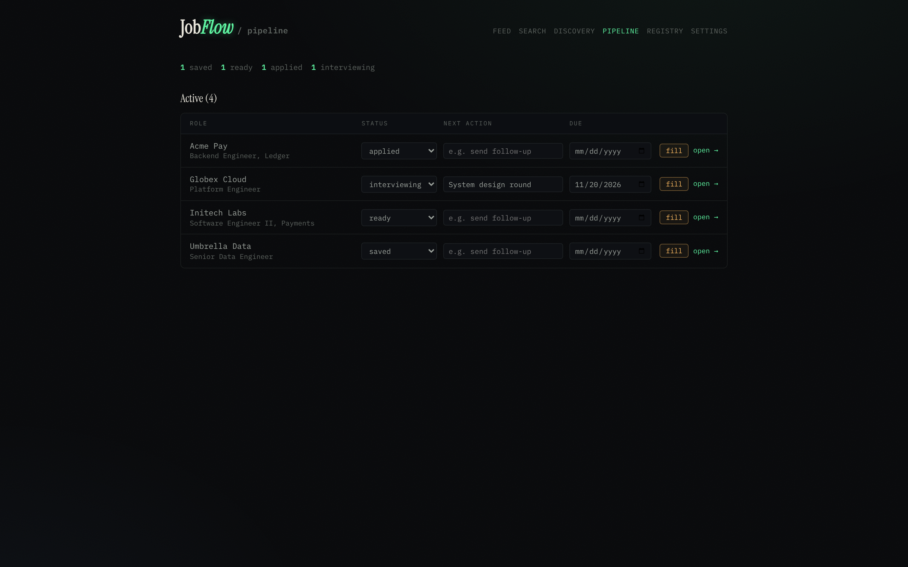

# The daily workflow

Once your profile is set up ([Getting started](../getting-started.md)), using JobFlow is a
loop:

**sync → triage → open a job → tailor → apply → follow up**

with saved searches running in the background. Each step below shows the CLI and the web app
side by side. They share the same data, so you can mix them; just don't run a CLI command that
writes while `jobflow serve` is up (see
[Troubleshooting](troubleshooting.md#your-jobflow-data-is-open-in-another-process)).

Run `pnpm jobflow` on its own at any time. It shows your profile, jobs, saved searches,
applications and model, and the one command to run next.

## 1. Sync

Fetch new postings from your presets, your own sources and your saved searches, then re-rank.

| CLI | Web app |
|---|---|
| `pnpm jobflow sync` (every due board, up to about 5 minutes) · `pnpm jobflow sync --full` (every due board and slow feed, no time limit) | **Sync now** on Jobs or on Sources. While `jobflow serve` is open it also syncs on its own every 6 hours. |

```
✓ Polled 25 board(s) + 9 feed(s): 812 postings fetched, 14 gone, 3 expired (74s)
  207 of 232 due boards wait for the next sync (run `jobflow sync` again, or `--full` for all of them now).
Your corpus: 1461 active postings · 1461 ranked for you.
next: jobflow feed
```

Each sync polls every board that is **due**: boards marked daily about once a day, the rest
once a week, new ones straight away, the most overdue first. It stops starting new boards
after about 5 minutes (`JOBFLOW_SYNC_MINUTES`), and whatever it didn't reach goes first next
time. The very first sync on a new install polls only 25 boards so you see jobs within a
couple of minutes; the next sync (or, in the web app, the next quarter-hour) picks up the
rest. On the India preset (~240 boards) the second sync reached all of them in under 5
minutes; after that a sync re-polls only what has come due. `--max-boards N` (or
`JOBFLOW_SYNC_MAX_BOARDS`) caps a run if you want it shorter.

"gone" are postings their board no longer lists, now retired. "expired" are feed postings
nobody re-confirmed within 14 days. If nothing comes back, see
[A sync finished but there are no jobs](troubleshooting.md#a-sync-finished-but-there-are-no-jobs).

## 2. Triage the feed

Go through the ranked list: save what's worth a look, hide what isn't, and leave the rest.

| CLI | Web app |
|---|---|
| `pnpm jobflow feed` · `-n 50 --min-score 70` · `--format table` · `--preset india` · `--search remote-backend` | **Jobs**: tabs for All, each saved search, Saved and Hidden; the filter rail; `j`/`k`, `s` save, `x` hide |
| `pnpm jobflow track add 3` (save it to your tracker) | **save** on a card (it lands in Applications as *Saved*) |



Read each card for:

- **The score and the stack line**: how close the role's stack is to yours. A near miss is a
  ramp-up note, not a hidden job.
- **The level and years asked**: "Posting is senior; you're mid", "asks 10+ yrs".
- **Pay**: *stated* is what the posting says; an *estimate* is labelled with its confidence.
- **Flags**: a US-only "remote" role, a staffing agency, a stale or re-posted listing.
- **Freshness**: see [how freshness works](#how-freshness-works-in-practice) below.

In the web app, filters only hide, and the page tells you how many they hid and why. Hidden
jobs stay under **Hidden** if you change your mind.

The list is spread across employers: one company never has more than 3 cards in any 20, and
its other good matches follow further down (never below jobs that score much lower; the
company's last card says "+N more at … further down" and links to the company). Scores don't change and nothing is hidden by
this; it just stops one big board with many similar roles from filling the first page. For
a strict score order use **score order only** (Filters → order) or `jobflow feed --no-diversify`.



## 3. Open a job

| CLI | Web app |
|---|---|
| `pnpm jobflow show 3` · `--jd` for the full description | Click the title (or `o`) for the **Job page** |

`show` prints the details, how you fit, your tracker status, any drafts, a **ready?** check
and the next commands. The Job page has the same, plus the Apply checklist:



Decide here. If it's not for you, **Hide from my Jobs** (or `x` on the list).

## 4. Tailor

Draft what you'll send. Everything is built from your résumé, Evidence Bank and skills, and
is never extended. Read [Applying](apply.md#from-the-web-app) for what each kind does.

| CLI | Web app |
|---|---|
| `pnpm jobflow tailor 3` (résumé bullets) · `--kind resume-md --out cv.md` · `--kind resume-latex --pdf` · `--kind cover --note "…"` · `--kind answer --question "…"` | **Tailor** (from a card, the Job page, or `t`) |

Without a model, résumés come from your own résumé as a template (labelled **builtin**), and
cover letters and answers refuse rather than fake it. See [LLM providers](llm-providers.md).

Make sure the draft is attached to the application. The CLI does this by default
(`--no-attach` to skip). In the web app, use **use for autofill** for the résumé and **Save to
application** for letters and answers. Then **Next: apply →**.

## 5. Apply

Three ways to apply. JobFlow never submits; you always press submit.

| Step | CLI | Web app (Job page → Apply) |
|---|---|---|
| Check what's ready | `pnpm jobflow apply 3`: a dry run showing the form URL, the résumé file, the cover letter, field-by-field what would be typed, and anything to fix first | The checklist (name, email, résumé file, cover letter) with a fix link for each gap |
| **Open** the form and apply yourself | `pnpm jobflow apply 3 --open` | **Open form** |
| **Pre-fill** it, then review and submit | `pnpm jobflow apply 3 --fill` | The command to copy (stop `jobflow serve` first), or **Pre-fill with the local agent** when the agent runs |
| Record it | Answer "yes" at the end of `--fill`, or `pnpm jobflow track status 3 applied` | **I submitted it — mark applied** |



The dry run also moves the job forward in your tracker: **ready** when nothing is missing,
otherwise **drafting**, with the fix as its next step. `--fill` needs a one-time setup
(`pnpm jobflow config set automation.fill on`, plus Playwright and Chromium). See
[Applying](apply.md) and [`apply --fill` won't start](troubleshooting.md#apply---fill-wont-start).



## 6. Follow up

Track where each application stands, and set a date for the next step.

| CLI | Web app |
|---|---|
| `pnpm jobflow track`: next actions first; row numbers work as refs | **Applications**: To apply · In progress · Closed |
| `pnpm jobflow track status 2 interviewing --note "Onsite next week"` | The status dropdown on the row or the Job page |
| `pnpm jobflow track next 2 "Send thank-you" --due 2026-12-01` | **next step** and **by** on the row; after "mark applied", the follow-up field on the Job page |

Statuses: `saved drafting ready applied screening interviewing offer rejected withdrawn
ghosted`. When a next step's date arrives, it shows under **Follow-ups due** at the top of
Applications. **done** clears it. The feed marks jobs you've already tracked or applied to, so
you don't apply twice.



## 7. Saved searches: the loop's background

A saved search runs on every sync (daily by default) and becomes a tab on Jobs. Saved searches
are how you watch a niche without repeating yourself.

| CLI | Web app |
|---|---|
| `pnpm jobflow search "backend engineer" --remote --posted 7d --save-as remote-backend` | **Search** → run it → **Keep this search** → **Save search** → **Open it in Jobs →** |
| `pnpm jobflow searches add berlin platform --loc "Berlin,DE" --no-source`: a view over your corpus only; it fetches nothing | |
| `pnpm jobflow feed --search remote-backend`: your feed through it, with hidden counts | The search's tab on Jobs (`/?view=<id>`) |
| `pnpm jobflow searches run remote-backend` · `searches rm remote-backend` | **run now** in Search → Saved searches |

Flags can go after the query, as above, or inside one quoted string
(`'"backend engineer" --remote --posted 7d'`); both save the same search. See
[Search & discovery](search-and-discovery.md#saved-searches).

## How freshness works in practice

- **Sync often enough.** Boards are polled on each sync; the web app syncs every 6 hours
  while it's open. If your last sync was more than a day ago, Jobs shows "Last sync was … —
  some of these may have closed" with **sync now**.
- **"Posted" is the earliest date JobFlow has seen**, not the latest re-stamp. Some boards
  re-date old listings, so a repost doesn't jump back to the top, and a posting is never newer
  than the first time JobFlow saw it. Aggregators known to re-date get a lower trust prior.
- **Postings disappear when their board drops them.** A board posting is retired only after a
  *complete* fetch of that board no longer lists it. A failed or partial fetch never retires
  anything. Postings from aggregators and feeds expire 14 days after they were last seen.
- **Top jobs are re-checked between polls** when the worker runs (the Docker setup): each one's
  own job page is probed, and only a definitive "gone" (404/410, or the board's closed flag)
  retires it. An error never does.
- **Re-polling never duplicates a posting.** The same job seen again just updates "last seen".

## A 10-minute routine

```bash
pnpm jobflow sync                    # or leave `jobflow serve` open: it syncs every 6 h
pnpm jobflow feed -n 15              # skim; save the good ones
pnpm jobflow track add 2             # …or `s` on Jobs
pnpm jobflow tailor 2 && pnpm jobflow apply 2      # check what's missing
pnpm jobflow apply 2 --fill          # review every field, press submit yourself, answer "yes"
pnpm jobflow track                   # anything due today?
```
