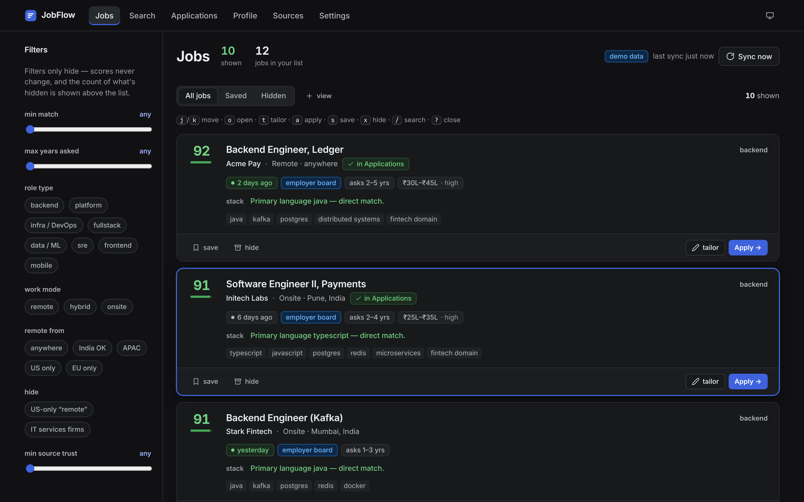

# Keyboard shortcuts

The **Jobs** page (`/`) can be driven from the keyboard. Press `?` to show the keys above the
list, and press `?` again to hide them.

## On Jobs

| Key | What it does |
|---|---|
| `j` | Move the selection down one job |
| `k` | Move the selection up one job |
| `o` or `Enter` | Open the selected job's [Job page](web-app-tour.md#the-job-page) |
| `t` | Open [Tailor](web-app-tour.md#tailor) for the selected job |
| `a` | Go to the selected job's **Apply** panel (`/jobs/<id>#apply`) |
| `s` | Save the selected job, or unsave it if it's already saved. Saving also adds it to Applications as *Saved*. |
| `x` | Hide the selected job, or bring it back if you're on the **Hidden** tab |
| `/` | Go to [Search](web-app-tour.md#search) |
| `?` | Show or hide the shortcut line |

The keys act on whichever tab you're looking at (All jobs, a saved search, Saved or Hidden),
after your filters have been applied.

### The first key only shows the selection

Nothing is selected when the page loads. Your first `j`, `k`, `o`, `t`, `a`, `s` or `x` only
highlights the top card. The next key acts on it. This way a stray key never hides or opens a
job you didn't see was selected. The selected card scrolls into view as you move.

### When the keys don't fire

The shortcuts are ignored when:

- the cursor is in a text box, a dropdown or any editable field (the search box, a slider
  you're dragging, and so on);
- you're holding Ctrl, Cmd or Alt, so browser shortcuts keep working;
- the filter sheet is open on a narrow screen. Close it first with Escape or **Show results**.

`Enter` on a focused button or link activates that control, not the selected card.

## Elsewhere

| Where | Key | What it does |
|---|---|---|
| The menu on a narrow screen | `Escape` | Close the menu and return focus to the menu button |
| The Jobs filter sheet on a narrow screen | `Escape` | Close the sheet |
| Profile → Skills & level, onboarding → Check what we found | `Enter` in "add a skill" | Add the skill you typed |
| Profile → What you want | `Enter` in the places box | Add the place you typed |
| Sources → Your own sources, All companies | `Enter` in the input | Add the source or company |
| Any page | `Tab` from the top | The first stop is **Skip to content** |

## In the terminal

The CLI is keyboard-only already. A few things make it faster:

- Row numbers from the last listing work everywhere: `jobflow show 3`, `jobflow tailor 3`,
  `jobflow apply 3`. Quote `'#3'` if you prefer the `#`.
- `pnpm jobflow` on its own prints where you are and the one command to run next.
- `jobflow profile edit` opens your profile in `$EDITOR`.

See the [CLI reference](../cli.md#referring-to-postings-1-ids-prefixes).
