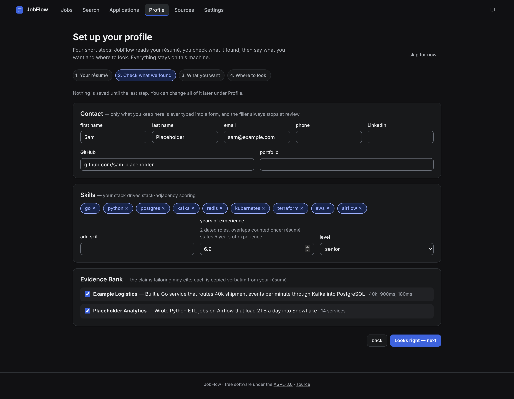
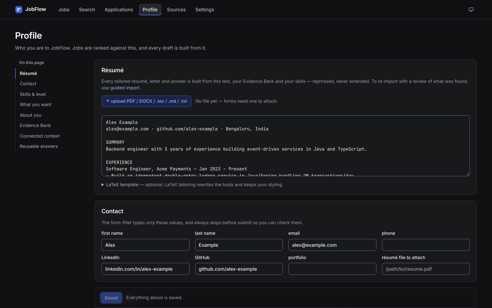
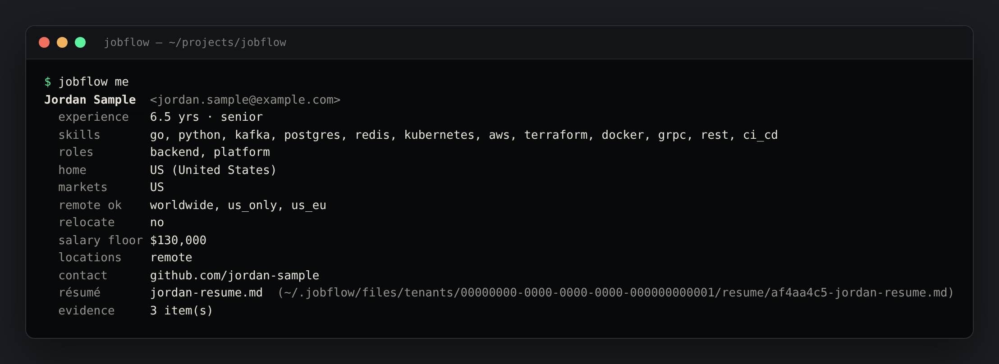

# Your résumé & profile

Your profile is what JobFlow ranks against and the only material it tailors from. It has
four parts:

| Part | What it is | Used for |
|---|---|---|
| **Base résumé** | the text (and, for LaTeX, the source) of your résumé | grounding for every tailored document and answer |
| **Evidence Bank** | individual, citeable claims — a project or role with a headline, detail and metric | the bullets tailoring may use; nothing outside it (or your résumé) is ever claimed |
| **Skills & level** | your stack, years of experience, level | stack-adjacency, seniority and experience-gap scoring |
| **Preferences** | home country, markets, remote regions, relocation, salary floor, role types, location weights | location, salary and archetype scoring; the two hard exclusions |

## Importing a résumé

```bash
pnpm jobflow profile import ./cv.pdf            # replaces your base résumé, adds evidence
pnpm jobflow profile import ./cv.docx --merge    # keeps what you have, fills gaps, unions skills
```

In the web app, use **onboarding** (`/onboarding`, opened on your first visit, from the Jobs
checklist, or from "guided import" on Profile). It has four steps, and nothing is saved until
the last one:

1. **Your résumé**: upload or paste it. If you have no résumé to hand, choose "type my skills
   instead", or try the fictional sample.
2. **Check what we found**: correct the contact details, skills, years and level, and choose
   which Evidence Bank items to keep.
3. **What you want**: where you can work, pay floor and role types.
4. **Where to look**: discovery presets, pre-selected from your home country.



To replace the résumé text without the review, use **Profile → Résumé** (upload a file or edit
the text).

| Format | Notes |
|---|---|
| PDF | Text PDFs only. A scanned PDF has no text layer — paste the text instead. Two-column layouts can come out in a strange order; review the draft. |
| DOCX | Paragraphs, bullets, tabs and line breaks are kept. |
| LaTeX (`.tex`) | The source is also kept as your tailoring template; tailoring rewrites only the document body and keeps your preamble byte-for-byte. |
| Markdown / text | As written. |
| JSON Resume | The [jsonresume.org](https://jsonresume.org) schema: basics, work highlights, projects, skills. |
| LinkedIn export | The `.zip` from LinkedIn → Settings → Data privacy → Get a copy of your data (or its `Positions.csv` / `Skills.csv` / `Profile.csv`). |

### What extraction does — and doesn't

The parser **copies spans from your file**. Evidence headlines and details are your own
bullet text, verbatim; metrics are numbers that appear in the bullet. Skills are matched
against a dictionary (unknown ones are offered for you to add, not dropped). Years of
experience are computed from dated roles, counting overlaps once.

With `--assist` (or the checkbox in the wizard) your configured LLM also reads the résumé.
Its output goes through a grounding filter: an evidence item survives only if ≥85% of its
words and every number appear in your file; a skill, contact field or role only if it's in
the text. Anything dropped is listed as a warning. With the offline `echo` provider, assist
does nothing.

You always review the draft before it's saved.

## Editing your profile

In the web app, **Profile** (`/profile`) is one page with a section menu:

- **Résumé** and an optional **LaTeX template**
- **Contact**
- **Skills & level**
- **What you want**
- **About you**
- **Evidence Bank**
- **Connected context**: optional, read-only background from your public GitHub repos, a
  LinkedIn data export, or your YC Work at a Startup profile text.
- **Reusable answers**

A sticky bar shows unsaved changes. **Save changes** re-ranks your jobs.



From the terminal:

```bash
pnpm jobflow me                                 # your profile + what's still missing
pnpm jobflow profile show
pnpm jobflow profile set home US
pnpm jobflow profile set markets US,CA
pnpm jobflow profile set floor "150000 USD"
pnpm jobflow profile edit                       # opens the editable fields in $EDITOR
pnpm jobflow evidence list
pnpm jobflow evidence add --project "Billing" --headline "Cut invoice latency 40%" --detail "…"
pnpm jobflow rank                               # re-score after changes that affect matching
```



**What you want** holds weighted signals, not filters. A job elsewhere, in another stack or at
another level is never hidden; it's scored lower, with an honest note. Only two things ever
leave a job out: pay the posting *clearly states* below your floor, and a location you can't
work from.

## Contact details & the form-filler

Only the contact fields you store are ever typed into an application form, and the filler
always stops before submitting. Set them in `jobflow init`, `jobflow profile set`, or
Profile → Contact. The **résumé file to attach** (`jobflow profile set resume-path …`) is the
file forms get when you haven't made a tailored PDF for that job. See [Applying](apply.md).

## Starting over / trying it out

`pnpm jobflow init --sample` (or "try with a fictional sample profile" in the wizard)
replaces your profile with **Alex Example**, an invented candidate. Sample evidence is
labelled, and the tailor warns before drafting from it.

To wipe everything and start from nothing, see
[Starting over](troubleshooting.md#starting-over-resetting-your-data). If a PDF won't parse,
see [Troubleshooting](troubleshooting.md#my-pdf-résumé-wont-parse).
