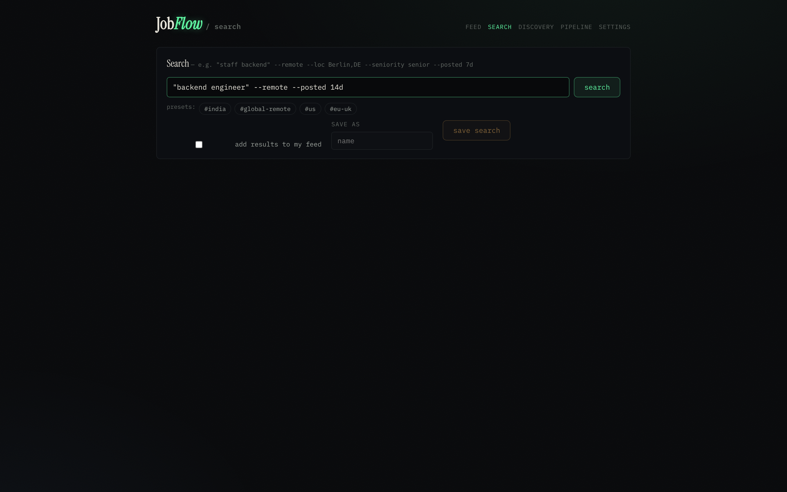
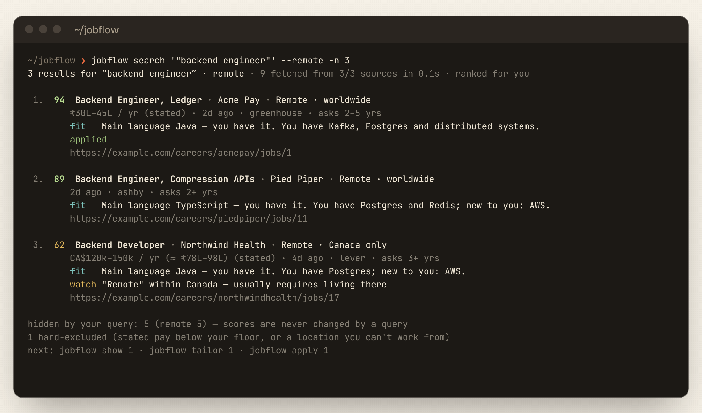
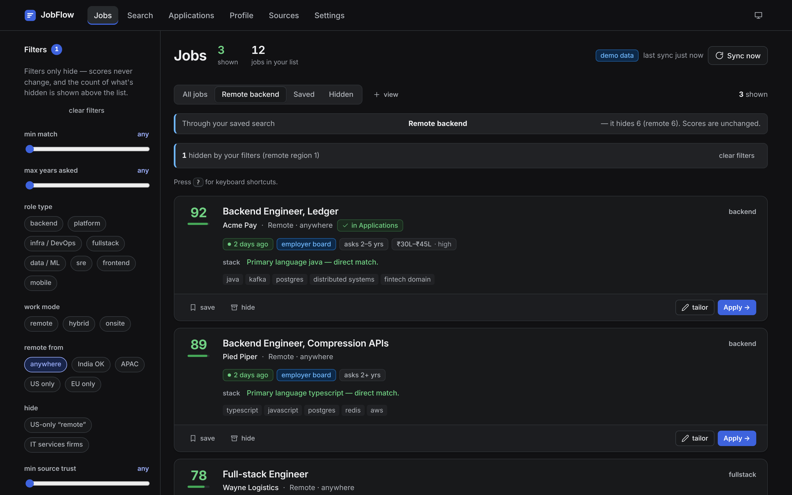
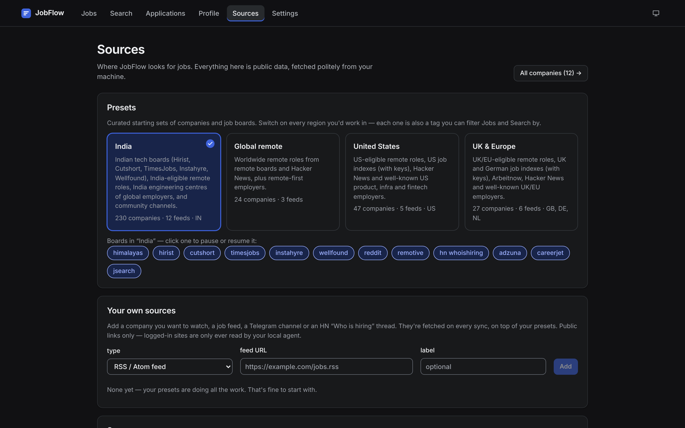

# Search & discovery

JobFlow finds jobs two ways:

- **Discovery** keeps a corpus of postings fresh: it polls company boards (Greenhouse,
  Lever, Ashby, Workable, SmartRecruiters, Workday and more) and job feeds on a schedule,
  and ranks everything against your profile. That's your **feed**.
- **Search** asks search-capable boards a specific question *now* — and can keep asking it
  on a schedule as a **saved search**.

## Search



In the web app, **Search** (`/search`; press `/` on Jobs to get there) takes the same query syntax as the
CLI. It has example chips to click, **only from presets** tags, and **All search options**
listing every flag. From the terminal:

```bash
pnpm jobflow search "backend engineer" --remote
pnpm jobflow search '"site reliability"' --loc "Toronto,CA" --seniority senior --posted 14d
pnpm jobflow search "data engineer" --min-salary "140000 USD" --sources himalayas,remotive
pnpm jobflow search "platform" --exclude-company "Acme" --limit 10 --json
```

| Flag | Meaning |
|---|---|
| `--remote` / `--onsite` | remote only / exclude remote |
| `--loc "City,CC"` | a city and/or ISO country; repeat or separate with `;` |
| `--country CC` | ISO country code(s) |
| `--seniority a,b` | `junior, mid, senior, staff, lead, principal, manager…` |
| `--min-salary "N CUR"` | only hides roles whose **stated** pay is below it |
| `--posted 7d` | recency (`7d`, `2w`, or days) |
| `--must a,b` / `--nice a,b` | skills: must-haves hide roles that state other stacks; nice-to-haves only reorder |
| `--sources a,b` | restrict to these sources |
| `--exclude-company`, `--exclude` | drop companies / keywords |
| `--preset a,b` | only roles from those presets' companies and feeds (a tag filter; with no `--sources`, searches those presets' feeds) |
| `--ingest` | also add the results to your feed |
| `--save-as NAME` | keep it as a saved search |



Results are scored with the feed's scorer. The query's filters are a **view**: a posting is
hidden only when the value is *known* (a confidently parsed location, a stated salary, a
detected level) — unknown values always pass — and every search reports how many it hid and
why. Scores are never changed by a filter.

Which sources answer depends on the query: Himalayas, Remotive, Arbeitnow, HN "Who is
hiring", Hirist, TimesJobs, Instahyre, Wellfound and Cutshort need no keys; Adzuna and
Careerjet need free keys; JSearch is paid and only used when you name it in `--sources`.

## Saved searches

```bash
pnpm jobflow search "backend engineer" --remote --posted 7d --save-as remote-backend   # search now, and keep it
pnpm jobflow searches add remote-backend "backend engineer" --remote --posted 7d       # or save without running
pnpm jobflow searches add berlin platform --loc "Berlin,DE" --no-source                 # a view over your feed only
pnpm jobflow searches list
pnpm jobflow searches run remote-backend
pnpm jobflow feed --search remote-backend       # your feed, through that search
pnpm jobflow searches rm remote-backend
```

Pass the flags as separate arguments, not inside the quoted query: in this release,
`searches add name '"backend engineer" --remote --posted 7d'` (all one string) is misparsed.

A saved search runs on each `jobflow sync` (daily by default) and its results join your
feed. With `--no-source` it fetches nothing and only works as a view over your feed. In the
web app, run a search, then under **Keep this search** press **Save search**. Each saved
search becomes a **tab on the Jobs page** (`/?view=<id>`) that says how many jobs it hides and
why:



## Discovery presets

A preset is a curated starting set of companies and feeds. Switch on **as many as you like** —
JobFlow polls the union:

| Preset | What it covers |
|---|---|
| `india` | Indian product companies, India offices of global firms, India job boards, community channels |
| `global-remote` | remote-first companies and remote boards, any country |
| `us` | US companies on Greenhouse / Lever / Ashby plus US aggregators |
| `eu-uk` | EU/UK companies and boards |

```bash
pnpm jobflow discovery presets              # all presets, on/off
pnpm jobflow discovery use india,global-remote
```

### Presets as tags

Every posting is tagged with the presets it belongs to (its company is in the preset's list,
or it came from one of the preset's feeds) — the cards show `#india`, `#us`, … Filter by them:

```bash
pnpm jobflow search "backend engineer" --preset us,eu-uk
pnpm jobflow feed --preset india
```

In the web app, the Jobs page's filter rail has a **preset** filter, and the Search page has
preset chips. Every rail filter is a view too: it only hides, scores never change, and the
page says how many jobs the filters hid, per reason, with a **clear filters** button.

Turn individual preset feeds off in the web app (**Sources**, `/sources`: click a board under a
preset to pause or resume it), or with `jobflow discovery disable <feed-id>`. Sources also shows
each of your own sources' last run, and has **Sync now**.



## Your own sources

Add as many as you like on top of the preset:

```bash
pnpm jobflow discovery add-company https://boards.greenhouse.io/examplecorp
pnpm jobflow discovery add-company "Example Corp"           # the ATS detector finds its board
pnpm jobflow discovery import-companies ./targets.csv       # name,careersUrl per line
pnpm jobflow discovery add-rss https://example.com/jobs.rss
pnpm jobflow discovery add-json https://example.com/jobs.json --map mapping.json
pnpm jobflow discovery add-telegram some_public_channel
pnpm jobflow discovery add-hn                               # latest "Who is hiring" thread
pnpm jobflow discovery list
pnpm jobflow harvest --telegram chanA,chanB                 # one-off: register boards linked from channels
```

In the web app, **Sources → Your own sources** adds feeds, Telegram channels and HN threads.
**All companies** (`/companies`) adds a company by name or careers URL, and lists every board
with its cadence, posting count and **poll** / **pause** buttons.

- **Company boards**: the detector turns a careers URL or name into an ATS board
  (Greenhouse, Lever, Ashby, Workable, SmartRecruiters, Workday, Eightfold, Oracle, Rippling,
  Jobvite, Kula, Keka, Zoho Recruit, Freshteam…) and polls it directly.
- **RSS/Atom and JSON feeds**: each item becomes a posting; a JSON feed takes a
  [field mapping](#json-feed-mapping). ATS links found in items are registered as boards.
- **Telegram channels / HN threads**: discovery only — their links to company boards are
  registered, and the posting is always read from the board itself.

User-supplied URLs must be public `https://` addresses (private and cloud-metadata
addresses are refused).

### JSON feed mapping

Dot-paths into the feed; defaults follow [jsonfeed.org](https://jsonfeed.org):

```json
{ "itemsPath": "jobs", "id": "id", "title": "title", "company": "company.name",
  "url": "apply_url", "location": "location", "description": "description",
  "postedAt": "published_at", "salary": "salary" }
```

## Freshness

Re-polling upserts postings (no duplicates) and records when each was last seen. A board
posting that disappears is retired, but only when the *whole* board was fetched
successfully; a failed or partial fetch never retires anything. Feed and aggregator postings
expire 14 days after they were last seen. Freshness scoring uses the earliest publish date
seen (and never one later than when JobFlow first saw the posting), so reposts don't look
new. When the worker runs (Docker / Postgres), it also re-checks the top cards' own job pages
between polls, and a definitive "gone" (404/410 or the board's closed flag) retires them.

While `jobflow serve` is open it syncs every 6 hours (`JOBFLOW_POLL_EVERY_HOURS`). See
[Daily workflow](daily-workflow.md#how-freshness-works-in-practice). If a sync brings back
nothing, see [Troubleshooting](troubleshooting.md#a-sync-finished-but-there-are-no-jobs).
