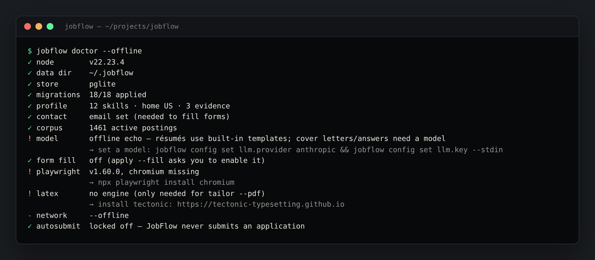

# Troubleshooting

Start with the setup check. It covers most of what can go wrong and prints a fix for each
problem:

```bash
pnpm jobflow doctor            # add --offline to skip the network and model checks
```



It checks:

- Node, the data directory and the store;
- that database migrations are applied;
- your profile and contact email;
- how many jobs you have;
- the model (with a one-token test call);
- Playwright and Chromium;
- a LaTeX engine;
- that two public job-board APIs are reachable;
- that auto-submit is locked off.

It exits 1 if anything fails.

- [Your JobFlow data is open in another process](#your-jobflow-data-is-open-in-another-process)
- [A sync finished but there are no jobs](#a-sync-finished-but-there-are-no-jobs)
- [Jobs aren't scored](#jobs-arent-scored)
- [What works without a model (echo)](#what-works-without-a-model-echo)
- [My PDF résumé won't parse](#my-pdf-résumé-wont-parse)
- [`apply --fill` won't start](#apply---fill-wont-start)
- [A LaTeX PDF won't compile](#a-latex-pdf-wont-compile)
- [Port 3000 is already in use](#port-3000-is-already-in-use)
- [Starting over: resetting your data](#starting-over-resetting-your-data)
- [Where are the logs?](#where-are-the-logs)

## "Your JobFlow data is open in another process"

The local database (PGlite, under `~/.jobflow/pgdata`) accepts **one writer at a time**. A
`.lock` file in the data directory guards it. If a second process tries to open it, the CLI
stops before it can damage your data:

```
Your JobFlow data is open in `jobflow serve` (http://localhost:3000, pid 12345).
  The local database is single-writer. Use the web UI while it runs, or stop it (Ctrl-C) and re-run this command.
```

The web app shows a similar message: "Your JobFlow data (…) is open in another process — the
local database takes one writer at a time. Close the other `jobflow` command or web server and
reload."

What to do:

- **`jobflow serve` is running.** Do the task in the web UI, or stop the server with Ctrl-C and
  run the command again. This is why the Job page tells you to stop `jobflow serve` before you
  run `jobflow apply <id> --fill`.
- **Another `jobflow` command is still running**, such as a long `sync --full`. Let it finish.
- **An AI agent is using JobFlow** through `jobflow mcp`. The MCP server releases the database
  after 20 s idle, so wait a moment, or until the agent's `sync_sources` finishes. If the web
  app is running, the agent's JobFlow tools say so too. See
  [AI agents (MCP)](ai-agents-mcp.md#the-single-writer-database).
- **Nothing is running** (a crash or a killed terminal left the lock behind). The message then
  ends with "If no jobflow process is running, delete the stale .lock file in the data dir":
  delete `~/.jobflow/.lock` (or `$JOBFLOW_DATA_DIR/.lock`).
- **You want several processes at once**, for example the web app and the
  [local agent](local-agent.md). Use Postgres instead of PGlite: set `DATABASE_URL` (or use
  Docker, below). You don't need a separate worker for the web app's maintenance buttons: on
  the local store, `jobflow serve` runs those jobs itself.

## A sync finished but there are no jobs

`jobflow sync` reports what it fetched. When nothing came back, it warns:

```
! Nothing was fetched. If you're online, a proxy or firewall may be blocking the job boards — `jobflow doctor` checks; `jobflow search …` asks other boards.
```

If no source answered at all, it exits 1. The web app shows "No jobs came back. The job boards
may be unreachable from here…" with **try again**.

Work through these:

1. **Are you online?** `pnpm jobflow doctor` tries two public job-board APIs.
2. **Is a proxy or firewall blocking the boards?** Corporate networks and some VPNs block the
   APIs JobFlow polls (Greenhouse, Lever, Ashby…). JobFlow uses Node's built-in `fetch`, which
   ignores `HTTPS_PROXY` by default. Recent Node 22 and 24 releases honour it when you also set
   `NODE_USE_ENV_PROXY=1`:
   ```bash
   HTTPS_PROXY=http://proxy.example.com:8080 NODE_USE_ENV_PROXY=1 pnpm jobflow sync
   ```
3. **Which sources answered?** `sync` prints a feed-by-feed summary and the first errors.
   **Sources** in the web app shows each of your own sources' last run.
4. **Is a preset switched on?** `pnpm jobflow sources` lists what `sync` polls. With no preset
   and no sources there is nothing to poll: `pnpm jobflow discovery use global-remote`.
5. **Try a live search instead.** `pnpm jobflow search "backend engineer" --remote` asks a
   different set of boards.

A plain `sync` is deliberately bounded (about 25 boards, 50 postings each, slow feeds skipped,
1–2 minutes). `pnpm jobflow sync --full` polls every due board and slow feed, and takes longer.

Some boards need keys and stay silent without them: Adzuna and Careerjet need free keys, and
JSearch is paid. See [configuration](../configuration.md).

## Jobs aren't scored

Scores need a profile. Before `jobflow init` (or onboarding in the web app), Jobs and search
results are **unscored**: the freshest postings, with no score and no notes about "your stack".
Run `pnpm jobflow init`, or `pnpm jobflow init --sample` to try the fictional candidate.

After you change your profile, re-score with `pnpm jobflow rank`. In the web app, **Save
changes** on Profile re-ranks for you.

## What works without a model (echo)

With no model configured, the provider is the offline `echo`. Everything except prose works:

| Works offline | Needs a model |
|---|---|
| Discovery, sync, search, ranking and rule-based match notes | Richer match write-ups for your top cards |
| Résumé import and review | `--assist` model-assisted extraction (does nothing on echo) |
| Résumé drafts, built from your own résumé and labelled **builtin** / "from your résumé (template)" | Rewritten Markdown and LaTeX résumés |
| Dry runs, opening forms, pre-filling forms | Cover letters, "why here", answers. These **refuse** rather than fake it. |

A cover letter without a model stops with exit code 4:

```
error: Writing a cover letter needs a generation model — the offline echo provider can't write prose.
set a model: jobflow config set llm.provider anthropic && jobflow config set llm.key --stdin
```

Offline ranking uses a local hashing embedder, which is a development fallback with weak
semantic matching. Stack, location and role-type signals do most of the ranking until you
configure a model. See [LLM providers](llm-providers.md).

## My PDF résumé won't parse

- **Scanned or image-only PDFs** have no text layer. If a PDF yields fewer than about 200
  characters, the import warns: "This PDF has almost no text — it looks scanned; paste the text
  instead." Paste the text (onboarding's "or paste the text", or
  `cat cv.txt | pnpm jobflow init --yes --resume -`), or export a DOCX from your editor.
- **A very short PDF** (a one-line test file, say) trips the same warning. That's expected.
- **Two-column layouts** can come out in an odd order. Check the review step, or upload the
  DOCX or the LaTeX source instead.
- **Other refusals** say exactly what's wrong:
  - "That file is … MB — the limit is 10 MB."
  - "That file is empty."
  - "Unsupported file. Upload a PDF, DOCX, .tex, .md, .txt, JSON Resume, or a LinkedIn export
    (or paste the text)."
- **A Word document with no text** warns: "The Word document has no text in it — paste the
  text instead."

Nothing is saved until you confirm the review. See [Your résumé & profile](resume-and-profile.md).

## `apply --fill` won't start

`--fill` needs three things, and it names whichever is missing (exit code 4):

| Message | Fix |
|---|---|
| "Form filling is off." | `pnpm jobflow config set automation.fill on` (once). It only ever fills; you always submit. |
| "Form filling is switched off by JOBFLOW_BROWSER=off." | An explicit `JOBFLOW_BROWSER=off` in your environment or `.env` always wins. Remove it. |
| "--fill needs Playwright, which isn't installed." | `pnpm add -w playwright && npx playwright install chromium` |
| "Playwright is installed but its Chromium isn't." | `npx playwright install chromium`, or set `JOBFLOW_CHROMIUM` to a Chrome/Chromium you already have (below) |
| "JOBFLOW_CHROMIUM is set to …, which doesn't exist." | Point it at your browser binary (for example `/usr/bin/google-chrome`, or `/Applications/Google Chrome.app/Contents/MacOS/Google Chrome` on macOS), or unset it |
| "No contact email in your profile — the form needs one." | `pnpm jobflow profile set email you@example.com` |
| "resumeFormat → forms want a PDF/Word file, not your .md/.tex/.txt source" (under "Fix before filling" in the dry run) | Make a PDF: `pnpm jobflow tailor <ref> --kind resume-md --pdf`, or point at one with `pnpm jobflow profile set resume-path ./resume.pdf` |
| "Couldn't start the browser: …" | `--fill` opens a visible browser window, so it needs a desktop session (not a headless SSH box). Use `jobflow apply <ref> --open` instead. |

`JOBFLOW_CHROMIUM=/path/to/chrome` makes the form-filler and the local agent use a Chrome or
Chromium you already have, so you can skip `npx playwright install chromium` (the Playwright
package itself is still needed). `pnpm jobflow doctor` then shows
`playwright  v… + /path/to/chrome (JOBFLOW_CHROMIUM)`.

Filling uses a persistent browser profile at `~/.jobflow/browser-profile`, so site logins
survive between runs. Use `--browser-profile <dir>` or `JOBFLOW_BROWSER_PROFILE` to pick
another one. See [Applying](apply.md).

## A LaTeX PDF won't compile

`tailor --kind resume-latex --pdf` and the web app's "typeset PDF" / "download PDF" need a
local LaTeX engine. JobFlow tries **tectonic**, then `xelatex`, then `pdflatex`. Without one:

```
No LaTeX engine found. Install tectonic (recommended) or MiKTeX/TeX Live, or download the .tex and compile in Overleaf.
  Install tectonic (https://tectonic-typesetting.github.io), or use --out resume.tex and compile in Overleaf.
```

- Install [tectonic](https://tectonic-typesetting.github.io) (a single binary) and put it on
  your `PATH`. Restart `jobflow serve` so the web app sees it.
- **The first compile takes minutes**, because tectonic downloads its package bundle. Later
  compiles are fast.
- A Markdown résumé needs no LaTeX: "Save as PDF" prints the preview.

`pnpm jobflow doctor` shows which engine it found.

## Port 3000 is already in use

- **`jobflow serve`**: pick another port, e.g. `pnpm jobflow serve -p 3001`. If the browser
  extension talks to it, change the server URL in the extension's options too.
- **Docker** (`pnpm docker:up`): the web app is published on `127.0.0.1:3000` and Postgres on
  `127.0.0.1:5433`. Port 5433 avoids a clash with a local Postgres on 5432. Both host ports are
  fixed in `docker-compose.yml`; stop whatever holds them, or edit the `ports:` lines there.
  `JOBFLOW_WEB_BIND` changes only the **address** the web port binds to (for example `0.0.0.0`
  behind a TLS proxy, see [self-hosting](self-hosting.md)), not the port.
- Running `jobflow serve` and Docker at the same time means two apps want port 3000. Run one
  of them.

## Starting over: resetting your data

Everything lives in one directory: `--data-dir`, else `$JOBFLOW_DATA_DIR`, else `~/.jobflow`.

```bash
pnpm jobflow init --force                     # redo onboarding, keeping jobs, sources and applications
JOBFLOW_DATA_DIR=~/jobflow-fresh pnpm jobflow init   # a second, separate install (try things out)
pnpm jobflow --store memory feed              # a throwaway in-memory run that saves nothing
rm -rf ~/.jobflow                             # delete everything: profile, jobs, drafts, browser profile
```

Stop `jobflow serve` before you delete the directory. With Docker, `pnpm docker:down` stops the
stack. The data lives in the `jobflow-db` and `jobflow-data` volumes;
`docker compose down -v` deletes them.

## Where are the logs?

| What | Where |
|---|---|
| CLI | Errors and hints go to stderr, results to stdout. `JOBFLOW_DEBUG=1 pnpm jobflow …` adds the stack trace to an error. |
| Web app (`jobflow serve`) | The terminal you started it from |
| Background jobs (sync, recheck, re-rank…) | Sources → Sync → **Maintenance and background jobs**: the activity list shows each job's state and result. On the local store, `jobflow serve` runs them and logs a `[jobflow] job ✓ …` / `✗ …` line per job in its terminal |
| A source that failed | Sources → Your own sources (last run per source); `jobflow sync` prints the first errors |
| Docker | `pnpm docker:logs` (web and worker; `docker compose logs db` for Postgres) |
| Local agent | The terminal running `pnpm agent` |

Still stuck? Open an issue with the output of `pnpm -s jobflow doctor --json` attached. Read it first: it shows your data directory path and a short profile summary (skill count, home country), but never your API key.
Report security issues privately ([SECURITY.md](../../SECURITY.md)).
