# A tour of the web app

The web app shows the same data as the CLI, in a browser. Start it with:

```bash
pnpm jobflow serve        # http://localhost:3000, on your local data
```

It only answers on localhost. While it runs it holds your data directory, so other `jobflow`
commands pause (see [Troubleshooting](troubleshooting.md#your-jobflow-data-is-open-in-another-process)).
It also keeps your jobs fresh: while it's open, it syncs every 6 hours (`JOBFLOW_POLL_EVERY_HOURS`).

The header has six pages, in the order you use them: **Jobs → Search → Applications →
Profile → Sources → Settings**. Every job also has a **Job page**, and from there a
**Tailor** page.

| Page | Address | What it answers | CLI equivalent |
|---|---|---|---|
| [Jobs](#jobs) | `/` | What should I look at today? | `jobflow feed` |
| [Job page](#the-job-page) | `/jobs/<id>` | Does this one fit, and how do I apply? | `jobflow show`, `jobflow apply` |
| [Tailor](#tailor) | `/tailor/<id>` | What do I send? | `jobflow tailor` |
| [Search](#search) | `/search` | Find me X right now. | `jobflow search`, `jobflow searches` |
| [Applications](#applications) | `/applications` | Where am I with each one? | `jobflow track` |
| [Profile](#profile) | `/profile` | Who am I to JobFlow? | `jobflow init`, `jobflow profile`, `jobflow evidence` |
| [Sources](#sources) | `/sources` | Where does it look? | `jobflow discovery`, `jobflow sync` |
| [Settings](#settings) | `/settings` | Model, applying, data, tokens | `jobflow config` |
| [Onboarding](#onboarding) | `/onboarding` | First-time setup | `jobflow init` |

## Jobs

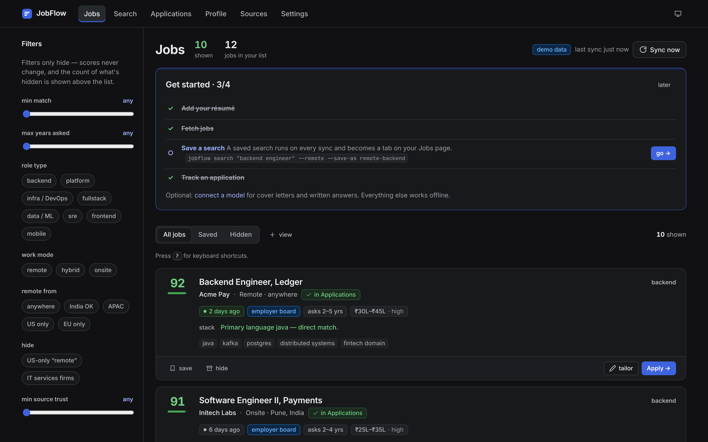

Jobs is the page you open every day: every job JobFlow knows about, ranked against your
profile. The top of the page shows how many jobs are **shown**, how many are **in your list**,
how many were **left out** for pay or location (the only two hard exclusions), when you last
synced, and a **Sync now** button.

### The get-started checklist

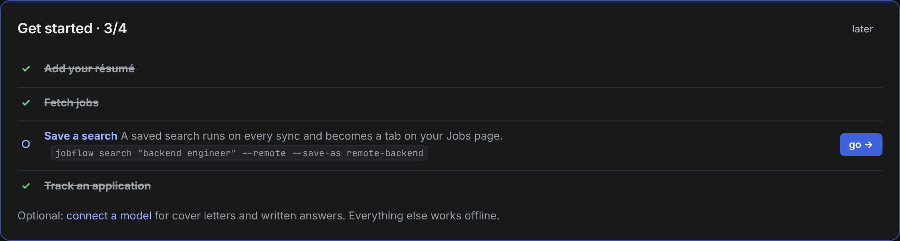

Until you've done the basics, a **Get started** panel sits on top. It has four steps, each
with a button and the matching CLI command:

1. **Add your résumé**: opens [onboarding](#onboarding) (`jobflow init`).
2. **Fetch jobs**: the first sync (`jobflow sync`). It runs in the background, and the page
   updates by itself when it's done.
3. **Save a search**: a saved search runs on every sync and becomes a tab here.
4. **Track an application**: save a job you like (`jobflow track add 1`).

"later" hides it until your next visit. Connecting a model is listed as optional; nothing else
depends on it.

Before you've added a résumé, Jobs shows the latest jobs **unscored**, with a banner saying
so. JobFlow never shows a fit score it can't back up.

### Match cards

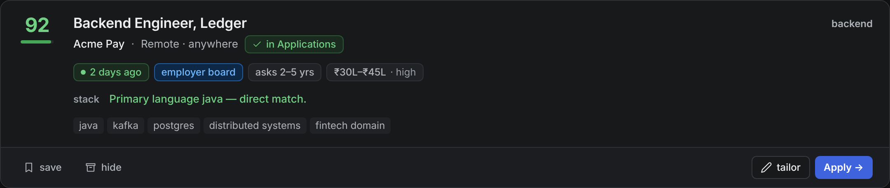

Each card shows:

- the **score**;
- the title, company and location;
- a **freshness** badge;
- the **source** (an "employer board" is the company's own ATS);
- the **years asked**;
- **pay**, stated or a labelled estimate, with its confidence;
- a **stack** note on how close the role's stack is to yours;
- the skills the posting mentions.

Caveats such as a large seniority gap, a "remote" role that's US-only, or a stale listing
appear as a highlighted flag:

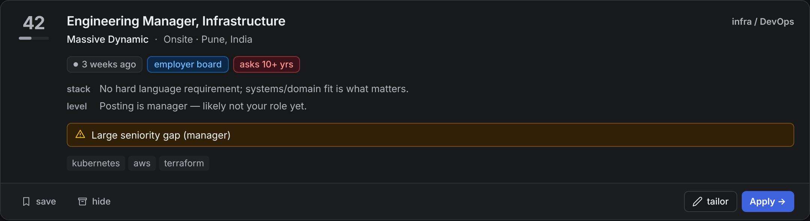

Card actions: **save** (keeps it, and adds it to Applications as *Saved*), **hide** (moves it
to the Hidden tab), **tailor**, and **Apply →** (the Job page's Apply panel). Click the title
for the [Job page](#the-job-page).

### Tabs: All, your saved searches, Saved, Hidden

The tab bar holds **All jobs** (**Latest jobs** before you're set up), then one tab per
[saved search](search-and-discovery.md#saved-searches), then **Saved** and **Hidden**.
"+ view" takes you to Search to create another. A saved-search tab has its own address
(`/?view=<id>`), so you can bookmark it.

### Filters, and the hidden-by-filters report

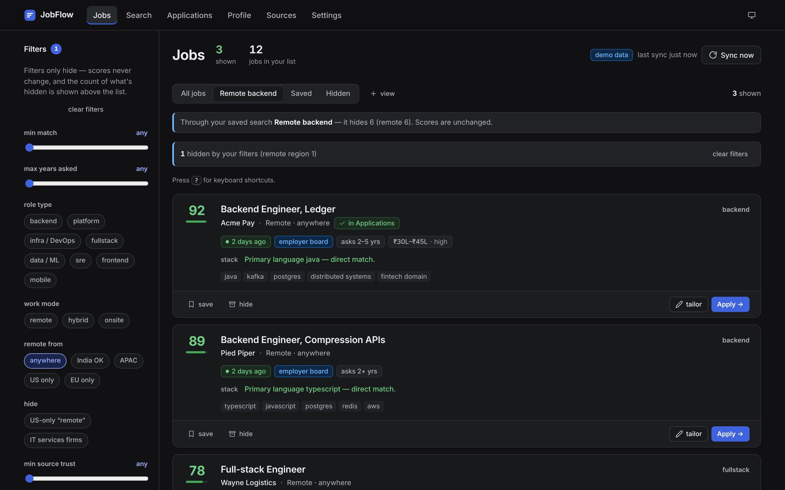

The filter rail on the left narrows the list by:

- min match;
- max years asked;
- preset tag;
- role type;
- work mode (remote / hybrid / onsite);
- remote region;
- hiding US-only "remote" roles or IT-services firms;
- min source trust.

Filters are **views**:

- They never change a score.
- A job whose value is unknown (no stated years, for example) is never hidden.
- The page always says what they hid: "**1** hidden by your filters (remote region 1)", with
  **clear filters**.

A saved-search tab adds its own line: "Through your saved search **Remote backend** — it hides
6 (remote 6). Scores are unchanged." If filters hide everything, the empty state says so
and offers to clear them.

On a phone, the rail collapses behind a **Filters** button (with a count of active filters) and
opens as a sheet. **Show results** closes it.

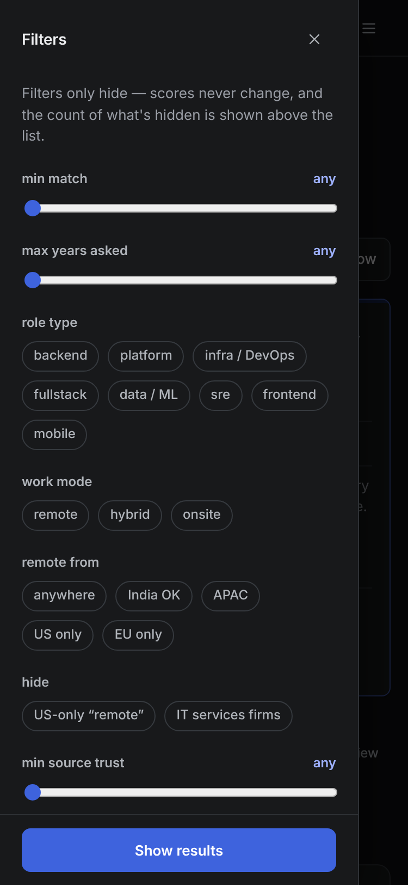

### Keyboard shortcuts

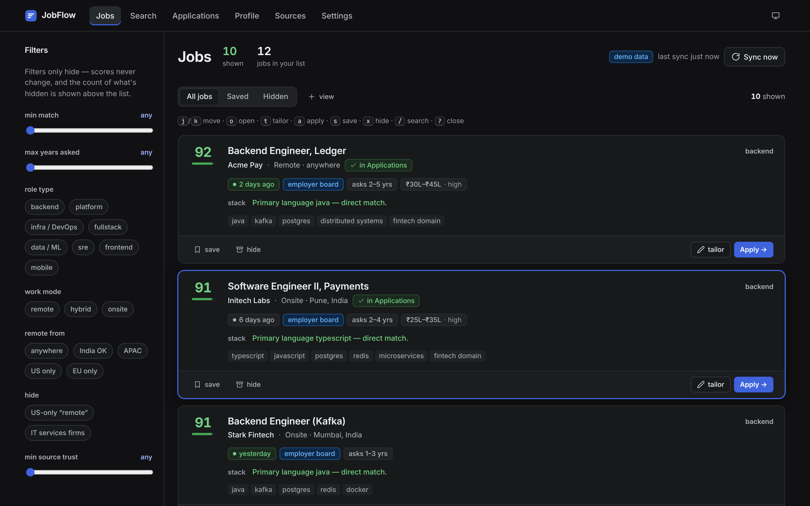

Press `?` to show the keys. `j`/`k` move, `o` or `Enter` opens, `t` tailors, `a` applies, `s`
saves, `x` hides, `/` goes to Search. The first key you press only shows the selection; the
next one acts. The details are in [Keyboard shortcuts](keyboard-shortcuts.md).

### Sync status

- **While a sync runs**, a banner says so and the page swaps in the new jobs by itself.
- **If a sync brings back nothing**, the banner says so plainly ("The job boards may be
  unreachable from here"), with **try again**, a link to Sources and a link to Search.
- **If the last sync was more than a day ago**, a banner warns that some jobs may have closed.

## The Job page

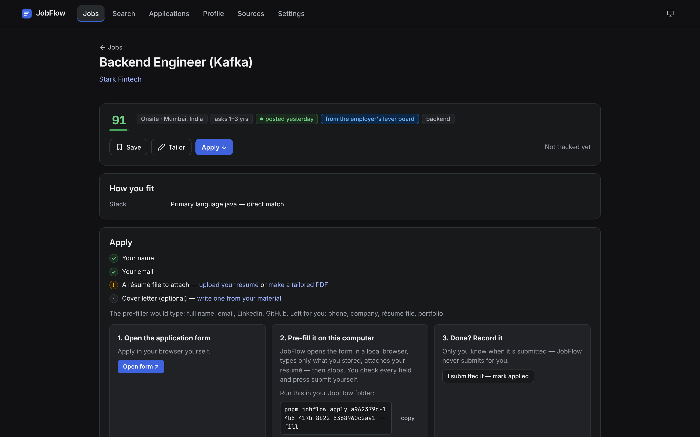

Click a job's title (or press `o`) to open it. Everything about one job is here:

- **Header**: the score, location, years asked, freshness, source and role type; **Save**,
  **Tailor** and **Apply ↓**; and where it stands in your tracker ("Not tracked yet", or a
  status you can change).
- **How you fit**: why it fits, the likely gap, the stack and experience notes, and **Check
  before applying** (red flags), or "No concerns found".
- **Apply**: the checklist and the three ways to apply (below).
- **Your drafts for this job**, with **Open Tailor →**.
- **Job description**: the full text, or a link to the original if the listing has none.
- **Not for you?**: **Hide from my Jobs**.

### The Apply panel

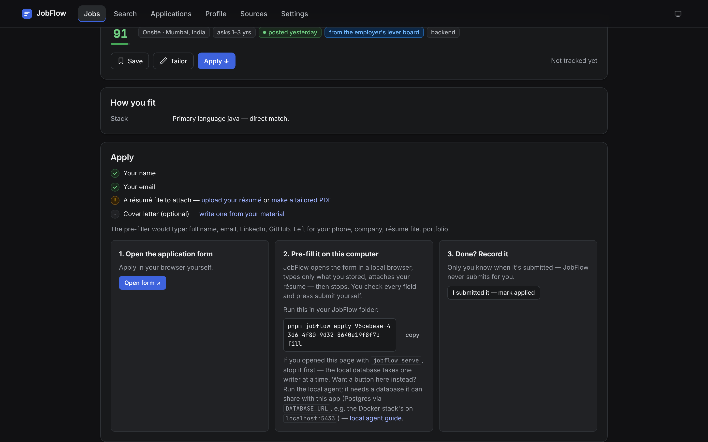

The checklist marks each item ready (✓), missing (!) or optional, and gives a fix link:

- your name;
- your email;
- a résumé file to attach;
- an optional cover letter.

Below the checklist, a line says what the pre-filler would type and what it leaves for you.
Then you have three options:

1. **Open the application form**: apply in your browser yourself.
2. **Pre-fill it on this computer**: the exact `pnpm jobflow apply <id> --fill` command, with
   a copy button. Stop `jobflow serve` first, because the database takes one writer at a time.
   If the [local agent](local-agent.md) is running, this becomes a **Pre-fill with the local
   agent** button. The agent needs a database it can share with the web app (Postgres via
   `DATABASE_URL`, such as the Docker stack's on `localhost:5433`), so it isn't available on the
   default local store.
3. **Done? Record it**: **I submitted it — mark applied**. Then you can add a next step and a
   follow-up date.

JobFlow never submits for you. See [Applying](apply.md).

## Tailor

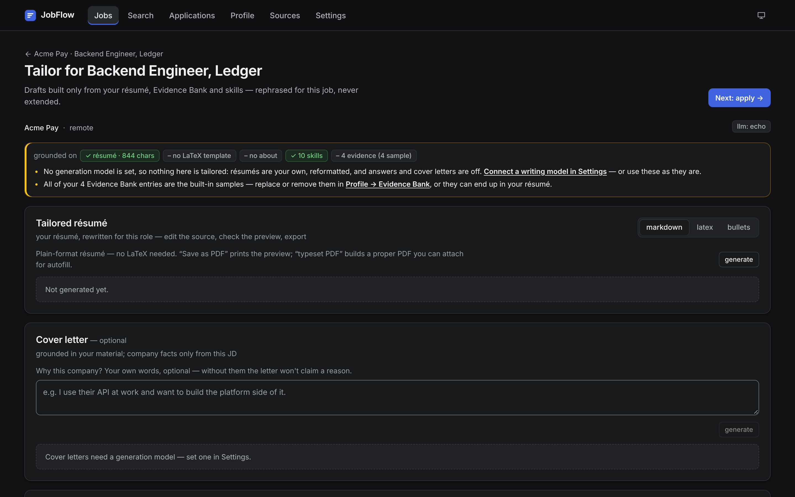

Open Tailor from a card, the Job page, or `t` on Jobs. A **grounded on** strip lists what drafts
can draw from: your résumé, a LaTeX template, your About note, your skills and your evidence.
It also warns about anything that weakens them, such as no model, or Evidence Bank entries
that are still the fictional samples.

| Section | What you get |
|---|---|
| **Tailored résumé** | **markdown**, **latex** or **bullets**. Edit the source, check the preview, then download (.md/.txt/.tex/PDF). **use for autofill** attaches it to this job's application. A LaTeX PDF needs [tectonic](troubleshooting.md#a-latex-pdf-wont-compile). |
| **Cover letter** (optional) | Grounded in your material. Add a "Why this company?" note in your own words, or the letter won't claim a reason. |
| **Why do you want to work here?** / **An interesting problem you've solved** | Editable answers with a word count and **copy**. |

Every draft is labelled with its source: *from your résumé (template)* without a model, or
*written by <model>*. A stale draft says why it's stale. **Save to application** attaches your
letter, answers and chosen bullets so the form-filler types them. **Next: apply →** takes you
back to the Apply panel.

Without a model, the cover letter and answers are switched off rather than faked. See
[LLM providers](llm-providers.md).

## Search

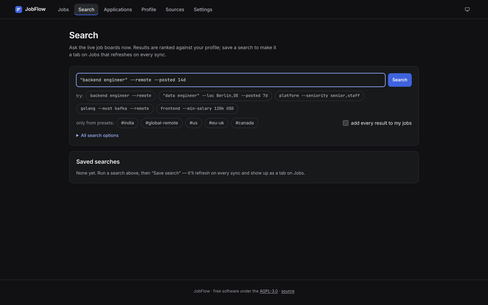

Type a query, with the same syntax as the CLI (`"backend engineer" --remote --posted 14d`).
You can also click an example chip, or narrow the search to presets with the **only from
presets** tags. **All search options** lists every flag.

Results are scored like Jobs. The page also reports:

- which sources answered;
- what your query hid, per reason;
- how many jobs were left out for pay or location.

When nothing matches, the page suggests ways to loosen the search: widen `--posted`, drop
`--seniority`, remove `--loc`, and so on.

**add every result to my jobs** saves all results into your list. Otherwise a search writes
nothing, except a result you open. Under **Keep this search**, name the search and press
**Save search**, then **Open it in Jobs →**. The **Saved searches** panel lists each search
with its last run and a **run now** button.

## Applications

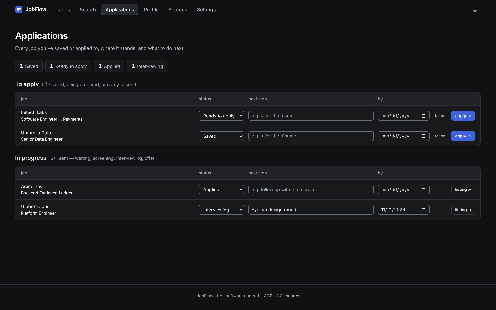

Every job you've saved or applied to, in three groups:

- **To apply**: saved, being prepared, ready.
- **In progress**: applied, screening, interviewing, offer.
- **Closed**: rejected, withdrawn, ghosted.

Each row has a status, a **next step** and a **by** date. Rows waiting to be sent have
**tailor** and **apply →** links; sent ones link to the listing. **Follow-ups due** collects the
next steps whose date has arrived, each with a **done** button. The counts at the top
summarize each stage.

## Profile

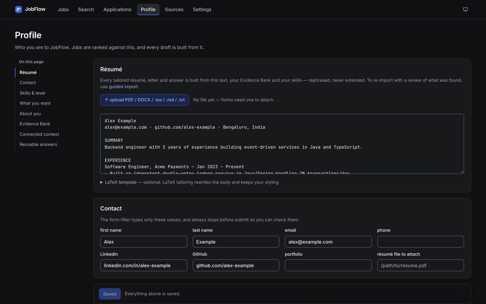

Your profile is one page with a section menu on the left:

- **Résumé**: upload a PDF, DOCX, .tex, .md or .txt file, or edit the text. A **LaTeX
  template** is optional; LaTeX tailoring rewrites the body and keeps your styling. "guided
  import" re-runs [onboarding](#onboarding) with a review of what was found.
- **Contact**: the only values the form-filler ever types, including the **résumé file to
  attach**.
- **Skills & level**: your stack (click a skill to remove it, or type to add one), years of
  experience and level.
- **What you want**:
  - home country, countries to search, salary floor and currency;
  - remote regions you can take;
  - role types;
  - places in order of preference.

  These are weighted signals, not filters.
- **About you**: a short note in your own words, used as background for drafts.
- **Evidence Bank**: concrete things you did. Every tailored bullet and answer rests on these,
  your résumé or your skills. Saved as you edit.
- **Connected context**: optional, read-only background for drafts: your public GitHub repos,
  a LinkedIn data export, or your YC Work at a Startup profile text.
- **Reusable answers**: company-agnostic "About me" and "An interesting problem I solved"
  (these need a model).

A sticky bar at the bottom shows unsaved changes. **Save changes** re-ranks your jobs. See
[Your résumé & profile](resume-and-profile.md).

## Sources

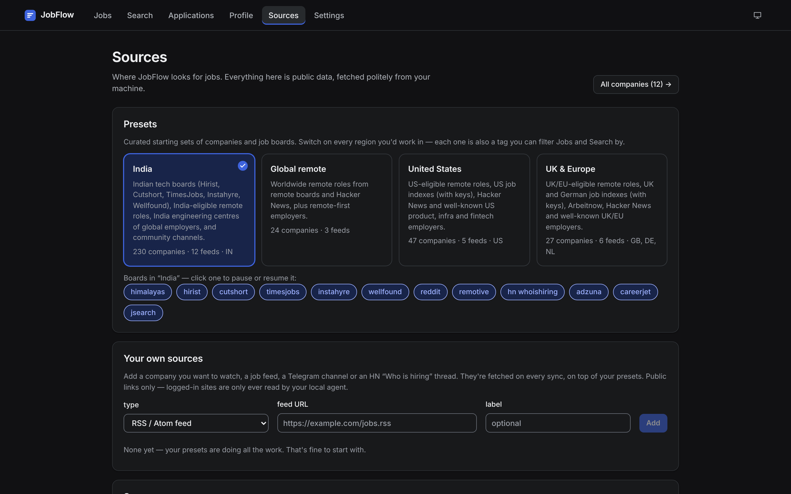

Where JobFlow looks:

- **Presets**: cards for India, Global remote, United States and UK & Europe, each with
  its company and feed count. Switch on every region you'd work in. Below them, click a board
  to pause or resume it.
- **Your own sources**: add an RSS/Atom feed, a JSON feed, a Telegram channel or an HN "Who is
  hiring" thread. Each one shows its last run.
- **Sync**: **Sync now**, the last sync time, and **Maintenance and background jobs**:
  - **recheck all jobs** and **retire old jobs**;
  - the background job queue (Discover, Poll all, Re-rank, Enrich comp, Recheck all);
  - the local agent's status.

  The maintenance buttons queue background jobs, and the activity list shows each one go from
  queued to done (or the error). On the default local store, `jobflow serve` runs them itself,
  one at a time. With Docker / Postgres the worker runs them. Local-agent jobs (pre-fill,
  logged-in sites) wait in the same list until the [local agent](local-agent.md) is online;
  the web server never runs them.
- **All companies** (top right) opens `/companies`, every company JobFlow polls. You can add one
  by name or careers URL, and each row has its ATS board, posting count, cadence, and
  **poll** / **pause** / remove.

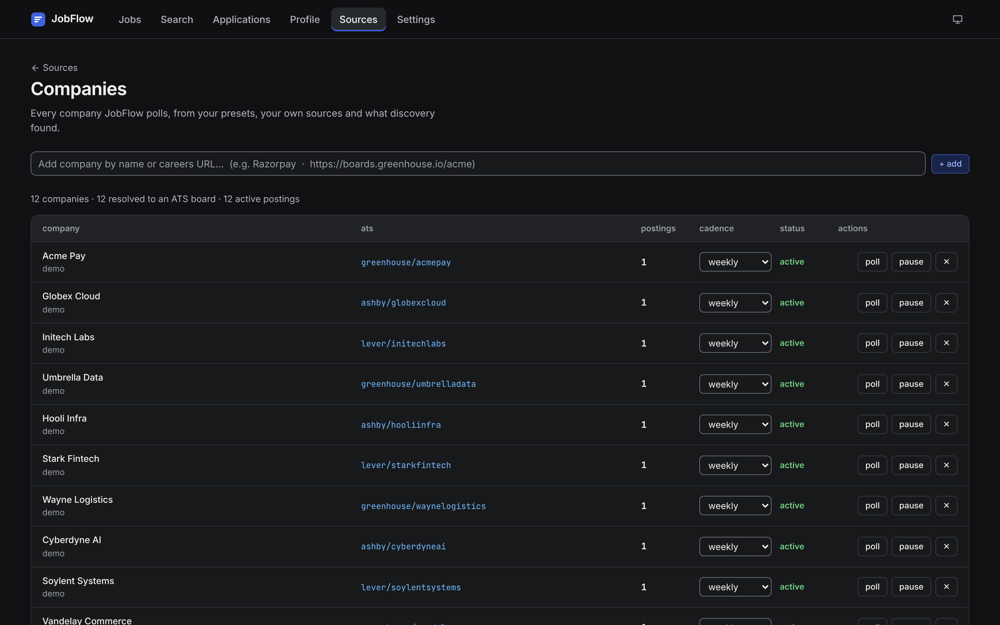

See [Search & discovery](search-and-discovery.md).

## Settings

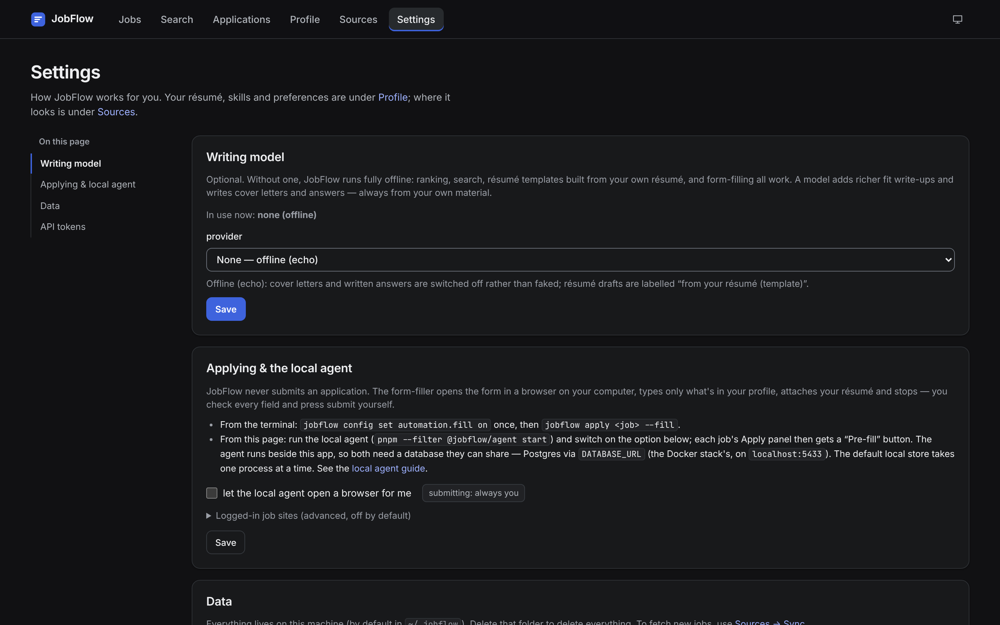

- **Writing model**: provider, key (write-only), model, and **Test connection**. "None —
  offline (echo)" keeps everything working except prose. See [LLM providers](llm-providers.md).
- **Applying & the local agent**:
  - how to pre-fill from the terminal (`jobflow config set automation.fill on`, then
    `jobflow apply <job> --fill`);
  - how to get a **Pre-fill** button instead: run the [local agent](local-agent.md), which
    needs a database it can share with the web app (Postgres via `DATABASE_URL`);
  - the **let the local agent open a browser for me** switch;
  - **Logged-in job sites** (advanced, off by default).
- **Data**: where your data lives (`~/.jobflow`), and **clear cached drafts**.
- **API tokens**: only needed when the server has sign-in on (a hosted instance): for the
  browser extension (paste it into its options page), the local agent
  (`JOBFLOW_AGENT_TOKEN`), or a script calling the server's API.

## Onboarding

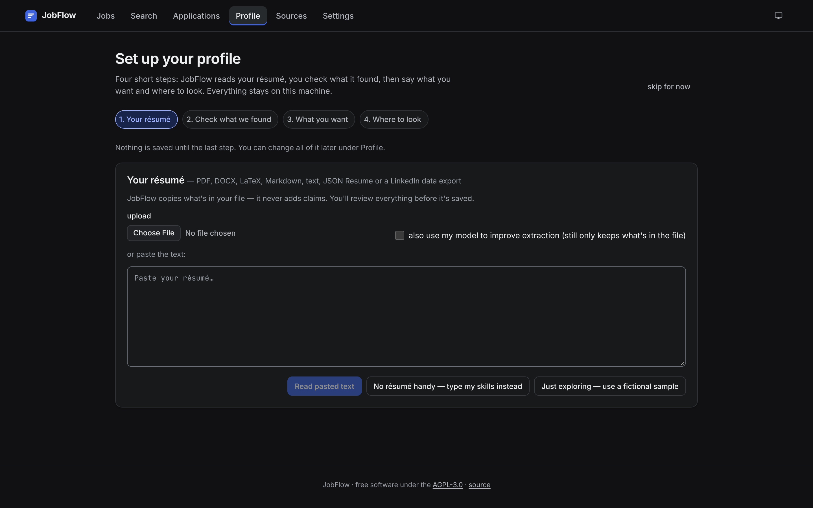

`/onboarding` opens on your first visit, or from the checklist or Profile. It has four steps,
and nothing is saved until the last one:

1. **Your résumé**: upload a file or paste the text. You can also choose **No résumé handy —
   type my skills instead**, or **Just exploring — use a fictional sample**. The checkbox
   "also use my model to improve extraction" only keeps what's in the file.
2. **Check what we found**: contact details, skills, years and level (with how they were
   worked out), and the Evidence Bank items to keep. Each item is copied verbatim from your
   résumé.

   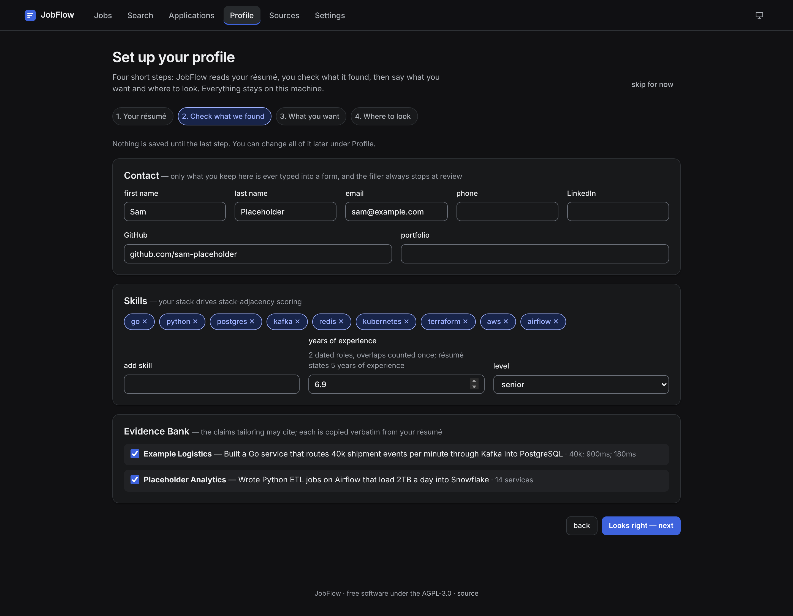

3. **What you want**: where you work, pay floor and role types.
4. **Where to look**: presets, pre-selected from your home country.

**Finish** takes you to Jobs, where the first sync starts and fills in by itself. "skip for now"
leaves setup for later.

## Light and dark themes

The theme follows your system. The button at the right of the header cycles **system → light →
dark**, and your browser remembers the choice.

<p>
  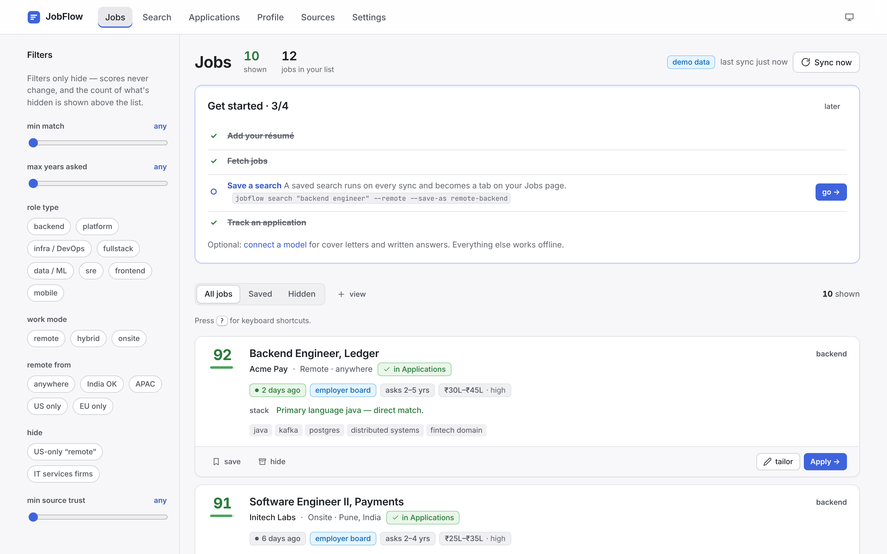
  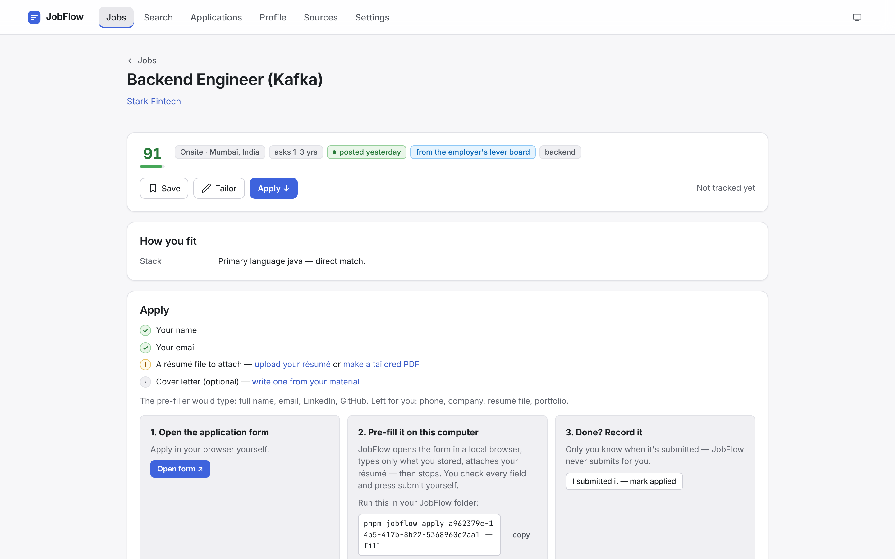
</p>

Other light captures: [Profile](../screenshots/profile-light.png) ·
[Search](../screenshots/search-light.png) · [Sources](../screenshots/sources-light.png) ·
[Settings](../screenshots/settings-light.png) · [Tailor](../screenshots/tailor-light.png).

## On a phone

Every page works at phone width. The nav collapses into a menu button (Escape closes it), and
the Jobs filters open as a sheet.

<p>
  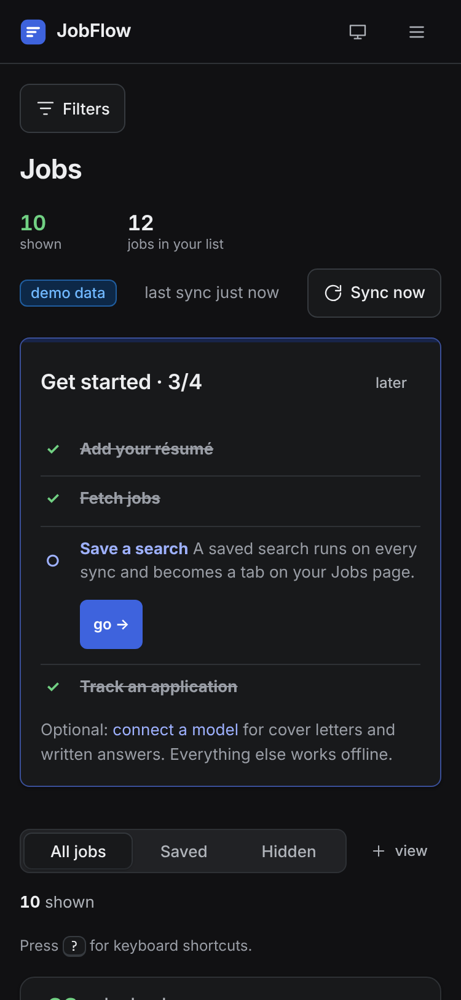
  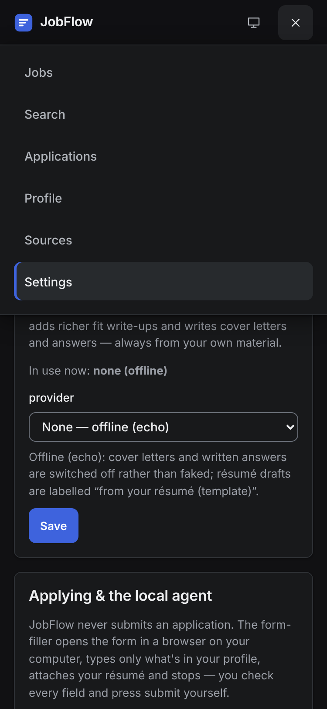
  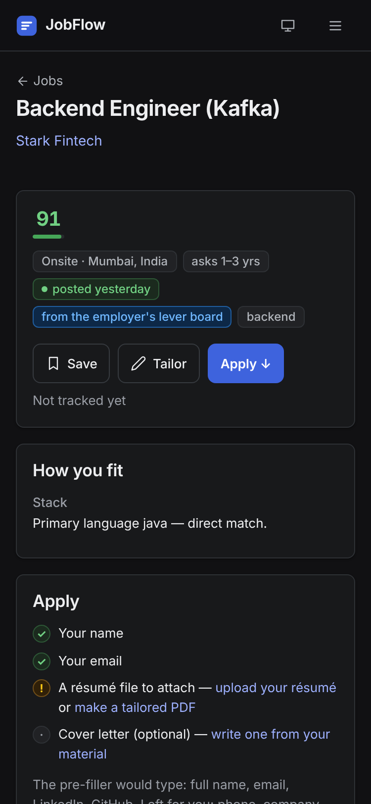
  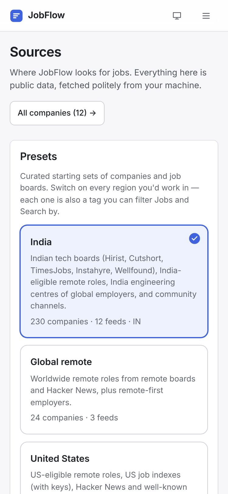
</p>

More: [Profile](../screenshots/profile-mobile.png) · [Settings](../screenshots/settings-mobile.png) ·
[Applications (light)](../screenshots/applications-mobile-light.png) · [Jobs (light)](../screenshots/jobs-mobile-light.png).

---

The screenshots come from `pnpm screenshots`, which runs the built app on an offline, fully
fictional demo corpus (`JOBFLOW_DEMO_DATA=1`). Next: [Daily workflow](daily-workflow.md).
